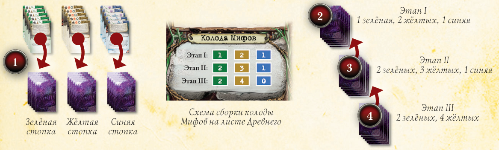
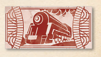
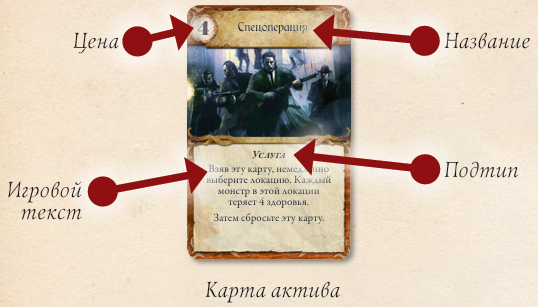
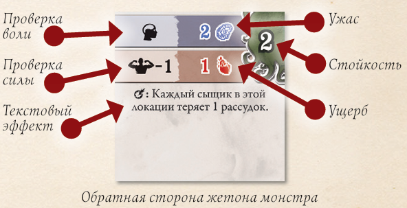
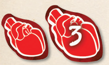

# ДРЕВНИЙ УЖАС

Данный буклет правил предназначен исключительно для опытных игроков в «Древний ужас», хорошо знакомых с правилами базовой игры и всех дополнений.
Из текста убрано большинство примеров и изображений.
Все права принадлежат правообладателям.
Автор комбинированных правил ставил своей задачей объединить все правила в один буклет.

## ОБ ИГРЕ

«Древний ужас» — командная приключенческая игра в жанре сверхъестественного ужаса по мотивам повестей и рассказов Говарда Ф. Лавкрафта.
Миру угрожает пробуждение Древнего — одного из невообразимо могущественных существ, населявших вселенную еще до начала времен.
Игроки берут на себя роли сыщиков, которые совместными усилиями должны разгадать мистические тайны, защитить человечество от жутких монстров и, в конечном счете, изгнать Древнего за пределы этого мира.
Если сыщики терпят поражение, Древний пробуждается — и человечество обречено!

### ИГРОКИ, СЫЩИКИ И ДРУГИЕ ВАЖНЫЕ МОМЕНТЫ

В «Древнем ужасе» у каждого игрока есть свой сыщик. В правилах слово «сыщик» относится и к персонажу игры, и к тому игроку, который им управляет.
- Когда вам надо найти половину от чего-либо, всегда округляйте вверх.
- Все споры разрешает ведущий сыщик.
- Имущество, действующее на сыщика, действует в том числе и на своего владельца, если только в описании не сказано, что оно действует на другого сыщика.

## ПОДГОТОВКА К ИГРЕ

Перед началом партии выполните следующие действия в указанном порядке:

0. ОТКРОЙТЕ СЛУЧАЙНУЮ КАРТУ ПРЕЛЮДИИ (ПО ЖЕЛАНИЮ ИГРОКОВ).

    Эти карты влияют на подготовку и делают каждую партию непохожей на остальные.

    Разыграйте открытую прелюдию немедленно, если на ней не указано иного — например, «после завершения подготовки».
    - Прелюдии *«Парад светил»* и *«Звезды заняли свои места»* предписывают подготовить колоду контактов в таинственных руинах.
    - Прелюдия *«Пророк из Антарктиды»* предписывает подготовить антарктическое игровое поле (см. [«Антарктическое игровое поле»](#антарктическое-игровое-поле)).
    - Прелюдия *«Под пирамидами»* предписывает подготовить египетское игровое поле (см. [«Египетское игровое поле»](#египетское-игровое-поле)).
    - Прелюдия *«Сны об Ином мире»* предписывает подготовить игровое поле Мира грез (см. [«Игровое поле Мира грез»](#игровое-поле-мира-грез)).

1. РАЗМЕСТИТЕ ИГРОВОЕ ПОЛЕ.

    Разверните игровое поле и поместите его посередине стола, чтобы все игроки могли до него дотянуться.

2. РАЗЛОЖИТЕ ЖЕТОНЫ.

    Распределите жетоны на столе следующим образом:
    1. Перемешайте основные жетоны врат и сложите их лицом вниз (картинкой с порталом вверх) в стопку рядом с полем.
    2. Перемешайте жетоны улик лицом вниз (картинкой с лупой вверх) и положите их рядом с полем в банк улик.
    3. Разделите по типам жетоны здоровья, рассудка, улучшений, билетов, ресурсов, собранности, Древних, слухов и тайны и положите их отдельными кучками рядом с полем.

3. ВЫБЕРИТЕ И РАЗМЕСТИТЕ СЫЩИКОВ.

    Игроки договариваются, кто из них получит жетон ведущего сыщика. Если они не могут договориться, жетон берет игрок, выбранный случайным образом (например, броском кубика).
    Начиная с ведущего сыщика и далее по часовой стрелке, каждый игрок выбирает одного сыщика, берет его лист, а затем ставит его фишку на игровое поле в локацию, указанную на обороте листа.

4. ПОЛУЧИТЕ СТАРТОВОЕ ИМУЩЕСТВО, ЛИЧНОЕ ЗАДАНИЕ, ЗДОРОВЬЕ И РАССУДОК.

    Каждый сыщик получает стартовое имущество, указанное на обороте его листа.
    Он берет себе соответствующие карты активов и заклинаний.
    Затем сыщик получает столько жетонов здоровья и рассудка, сколько указано на лицевой стороне его листа (см. [«Здоровье и рассудок»](#здоровье-и-рассудок)).
    Также сыщик получает карту личного задания и кладет её рядом со своим листом сыщика и имуществом (опционально).

    ***Примечание:** Перед подготовкой к игре игроки должны совместно решить, хотят ли они играть с личными историями. Личные истории должны быть либо у всех, либо ни у кого.*

5. ВЫБЕРИТЕ ДРЕВНЕГО.

    Игроки решают, какой из Древних будет противостоять им в этой партии.
    Игра против разных Древних протекает по-разному.
    Положите лист выбранного Древнего возле игрового поля лицом вверх (значением безысходности в левом верхнем углу) и выполните инструкции из раздела «Подготовка».

6. СОЗДАЙТЕ ПУЛ МОНСТРОВ.

    Сложите все жетоны монстров, кроме эпических, в мешочек и потрясите его, чтобы перемешать жетоны монстров.
    Не кладите в пул жетоны эпических монстров.
    Эпические монстры отличаются красным фоном и усеченным углом (см. [«Эпические монстры»](#эпические-монстры)).

7. РАЗДЕЛИТЕ И ВЫЛОЖИТЕ КОЛОДЫ.

    Уберите в коробку все карты поисковых контактов, особых контактов и тайн, которые не соответствуют выбранному Древнему.
    Эти карты не участвуют в данной игре.

    У каждого Древнего есть две индивидуальные колоды карт: колода тайн и колода поисковых контактов.
    У некоторых Древних также есть одна или несколько колод особых контактов, упомянутых на их листах в разделе «Подготовка».
    На рубашках индивидуальных карт изображен тот Древний, к которому они относятся.

    Разделите все остальные карты и разместите их возле игрового поля:
    - Затасуйте в одну колоду все карты экспедиционных контактов, независимо от их рубашек.
    - Перетасуйте карты заклинаний, состояний и уникальных активов тремя отдельными колодами лицом вверх.
    - Отложите карты Мифов — они понадобятся для следующего шага.
    - Разложите все оставшиеся карты по колодам согласно их рубашкам и перетасуйте каждую колоду по отдельности.

    **Важно:** Карты *контактов в таинственных руинах* используются, только если Древним выбраны *Незапамятный* или *Сизигия*, или была открыта соответствующая прелюдия *«Парад светил»* или *«Звезды заняли свои места»*.
    В этом случае затасуйте в одну колоду все карты контактов в таинственных руинах, независимо от их рубашек.

8. СОБЕРИТЕ КОЛОДУ МИФОВ.

    

    Создайте колоду Мифов согласно инструкциям на листе Древнего.
    Эта колода в каждой игре создается по-разному, в зависимости от инструкций на листе Древнего.

    Чтобы собрать эту колоду, сделайте следующее:
    1. Разделите все карты Мифов по цвету их лицевой стороны на три стопки: зеленую, желтую и синюю. Перетасуйте отдельно каждую стопку и положите лицом вниз.
    2. Соберите первый этап колоды Мифов: возьмите случайно вытянутые карты нужных цветов в нужном количестве (как указано на листе Древнего) и перетасуйте их, не глядя на лицевую сторону.
    3. Таким же образом соберите второй этап колоды Мифов и подложите **под карты** первого этапа.
    4. Наконец, соберите третий этап колоды Мифов и подложите **под карты** второго этапа, чтобы получилась единая колода.
    5. **Не тасуя эту колоду**, разместите ее рубашкой вверх возле листа Древнего.
    6. Уберите в коробку все оставшиеся карты Мифов, не просматривая их.

9. РАЗЫГРАЙТЕ СТАРТОВЫЕ ЭФФЕКТЫ.

    1. Положите рядом с колодой Мифов памятку, соответствующую числу игроков. Информация на этой памятке понадобится при розыгрыше карт Мифов. Лишние памятки уберите в коробку.
    2. Поместите жетон безысходности на деление шкалы безысходности, указанное в левом верхнем углу листа Древнего.
    3. Положите жетон знамений на зеленое деление (с кометой) круга знамений.
    4. Выложите четыре верхние карты колоды активов лицом вверх на четыре ячейки резерва (в левой нижней части игрового поля).
    5. Откройте столько врат, сколько указано в памятке. В локацию каждых врат выложите вслепую по одному монстру из пула.

        Чтобы открыть врата, возьмите из стопки врат верхний жетон и положите его лицом вверх в указанную на нем локацию.

    6. Положите жетон текущей экспедиции в локацию, изображенную на рубашке верхней карты в колоде экспедиционных контактов.
    7. Выложите на поле столько улик, сколько указано в памятке.

        Чтобы выложить улику, вытяните из банка улик один жетон и положите его лицом вниз в локацию, указанную на лицевой стороне жетона.

    8. Вытяните одну карту тайны и положите ее лицом вверх возле листа Древнего. Затем выполните то, что сказано на этой на карте после слов *«Когда эта карта входит в игру»*.
    9. Если используются карты контактов в таинственных руинах, положите жетон таинственных руин в локацию с рубашки верхней карты этой колоды.

## ЦЕЛЬ ИГРЫ

«Древний ужас» — командная игра.
Игроки находятся на одной стороне и побеждают или проигрывают все вместе.
Конечная цель сыщиков — разгадать тайны, чтобы изгнать Древнего за пределы мира (см. [«Тайны»](#тайны)).

Кроме того, сыщики столкнутся с множеством бедствий и опасностей, грозящих всему миру.
Они возникают в виде врат, которые порождают монстров и могут пробудить Древнего, и карт ***слухов***, наносящих сыщикам вред и способных преждевременно закончить игру.

Подробности — в разделе [«Победа в игре»](#победа-в-игре).

## ХОД ИГРЫ

Каждая партия в «Древний ужас» длится некоторое количество игровых раундов.

Раунд состоит из трех фаз, которые разыгрываются в следующем порядке:
1. **[ФАЗА ДЕЙСТВИЙ](#фаза-действий):** сыщики совершают действия, перемещаясь по игровому полю и готовясь к будущим приключениям.
2. **[ФАЗА КОНТАКТОВ](#фаза-контактов):** сыщики сражаются с монстрами или вступают в контакт в своей текущей локации.
3. **[ФАЗА МИФА](#фаза-мифа):** ведущий сыщик разыгрывает одну карту Мифа. Обычно эти карты поднимают безысходность, открывают врата или вызывают другие проблемы, которые должны будут решать сыщики.

В конце каждой фазы Мифа ведущий сыщик может передать жетон ведущего сыщика любому игроку на свой выбор.
После этого сыщики начинают новый раунд с фазы действий.
Это продолжается, пока игроки не победят или не проиграют.

### ФАЗА ДЕЙСТВИЙ

В течение этой фазы каждый сыщик может выполнить **до двух действий** в раунд.
С помощью действий сыщики перемещаются по игровому полю и приобретают полезные карты и жетоны (например, активы и билеты).

Ведущий сыщик первым совершает два действия на свой выбор.
Затем свои два действия выполняет сыщик слева от него, и так далее, пока каждый игрок не совершит свои действия.

В этой фазе сыщикам доступны следующие действия (их детальное описание вы найдете ниже):
* [Путешествие](#путешествие).
* [Подготовка к путешествию](#подготовка-к-путешествию).
* [Приобретение активов](#приобретение-активов).
* [Отдых](#отдых).
* [Сбор ресурсов](#сбор-ресурсов).
* [Обмен](#обмен).
* [Получение собранности](#получение-собранности).
* [Особое действие](#особое-действие)

**Важно:** сыщик может совершить каждое действие только ***один раз в раунд***.
Например, сыщик не может дважды отдохнуть.

#### ПУТЕШЕСТВИЕ

Сыщик перемещает свою фишку в любую соседнюю локацию.
Каждая локация соединена как минимум с одной соседней локацией линиями, которые называются путями.
У каждого пути есть свой тип (цвет), который соответствует виду билета.

После перемещения сыщик может потратить сколько угодно билетов, чтобы переместиться еще на одну локацию за каждый билет:
- Чтобы поехать поездом, нужно потратить билет на поезд.
- Чтобы поплыть на корабле, нужно потратить билет на корабль.

#### ПОДГОТОВКА К ПУТЕШЕСТВИЮ

Если сыщик находится **в городе**, он получает один билет по своему выбору:
- Билет на поезд можно взять только при наличии хотя бы одной железной дороги.
- Билет на корабль можно взять только если к городу ведет хотя бы один путь корабля.

Если у сыщика оказывается больше двух билетов, он должен оставить себе два из них по своему выбору, а остальные сбросить.

#### ПРИОБРЕТЕНИЕ АКТИВОВ

Если сыщик находится городе ***без монстров***, он может попытаться получить активы из резерва.
Для этого сыщик проходит проверку навыка общения и берет из резерва активы на свой выбор.
Сыщик может потратить любое число жетонов ресурсов, чтобы добавить к результату броска один успех за каждый потраченный ресурс.
Общая **цена** взятых активов не должна превышать числа выпавших успехов (см. [«Проверки»](#проверки)).

Если сыщик не взял ни одной карты, он может сбросить одну карту из резерва на свой выбор.

После приобретения активов карты, которые были взяты или сброшены из резерва, заменяются новыми картами из колоды активов.

**Важно:** Сыщик **не может** приобретать активы, если в одной локации с ним находится монстр.

#### ОТДЫХ

В локации ***без монстров*** сыщик восстанавливает *1 здоровье* и *1 рассудок* (см. [«Здоровье и рассудок»](#здоровье-и-рассудок)).
Можно тратить ресурсы для дополнительного восстановления одного здоровья или одного рассудка за каждый потраченный ресурс.

**Важно:** Сыщик **не может** отдыхать, если в одной локации с ним находится монстр.

#### СБОР РЕСУРСОВ

Выполнив это действие в любой локации, сыщик получает один жетон ресурса.

**Важно:**
- Ресурсы считаются имуществом.
- У сыщика не может быть более двух жетонов ресурсов одновременно.
- Ресурсы можно тратить на [отдых](#отдых), [приобретение активов](#приобретение-активов) или передавать при [обмене](#обмен).

#### ОБМЕН

Сыщик может обменяться имуществом (активами, артефактами, уликами, заклинаниями, билетами и ресурсами) с другим сыщиком, который находится в одной локации с ним.

#### ПОЛУЧЕНИЕ СОБРАННОСТИ

Выполнив это действие в любой локации, сыщик получает один жетон собранности.

Сыщик может потратить один жетон собранности, чтобы перебросить один кубик в ходе проверки.
На переброс кубиков можно тратить любое число жетонов собранности.

У сыщика не может быть более двух жетонов собранности одновременно.

#### ОСОБОЕ ДЕЙСТВИЕ

Сыщик может совершить действие, указанное на одном из его игровых компонентов (например, на карте или на листе сыщика).
Эти действия описаны после слова **«Действие»**, выделенного жирным шрифтом.
- Сыщик может выполнить особое действие *каждого своего компонента* только раз в раунд.
- За раунд разрешается совершить несколько особых действий с разных компонентов.
- Сыщик может совершить некоторые действия, указанные на компонентах других сыщиков в одной локации с ним.
Описания таких действий начинаются со слов **«Местное действие»**, выделенных жирным шрифтом.

---

### ФАЗА КОНТАКТОВ

В течение этой фазы каждый сыщик вступает **в один контакт**.
Как правило, для этого он читает небольшой текст на карте, где описана суть контакта и его последствия, пагубные или благоприятные.

Если во время фазы контактов сыщик находится в локации, где есть один или несколько монстров, он **должен** вступить в [боевой контакт](#боевые-контакты) с **каждым** монстром в этой локации.
Если монстров в его локации нет, сыщик вместо этого вступает в контакт в локации или в контакт жетона по своему выбору (см. ниже).

**Первым в контакт вступает ведущий сыщик.**
Следующим идет на контакт сыщик слева от него, и так далее, пока каждый игрок не вступит в один контакт.

---

#### БОЕВЫЕ КОНТАКТЫ

Если сыщик находится в локации, где есть один или несколько монстров, он должен вступить в боевой контакт сначала с каждым неэпическим монстром в своей локации в любом порядке, а уже потом — с каждым эпическим монстром в этой локации в любом порядке.

Вступив в боевой контакт с монстром, сыщик переворачивает его жетон и читает текст на обороте.
Затем, чтобы определить исход боевого контакта, сыщик проходит две проверки: сперва [**проверку воли**](#проверка-воли), затем [**проверку силы**](#проверка-силы).

Если после того, как сыщик разыграл все свои боевые контакты, монстров в его локации не осталось, он **может сразу же вступить в другой контакт**.

##### **ПРОВЕРКА ВОЛИ**

Сыщик проходит проверку воли, указанную на жетоне монстра.
Если значение **ужаса** монстра больше, чем число выпавших успехов («5» и «6»), сыщик теряет 1 рассудок за каждую единицу разницы.

##### **ПРОВЕРКА СИЛЫ**

Сыщик проходит проверку силы, указанную на жетоне монстра.
Если значение **ущерба** монстра больше, чем число выпавших успехов («5» и «6»), сыщик теряет 1 здоровье за каждую единицу разницы.

Монстр теряет столько здоровья, сколько успехов выпало.
Чтобы отметить это, положите на жетон монстра нужное количество жетонов здоровья из банка.
Если монстр потерял столько здоровья, какова его стойкость (или больше), он побежден и возвращается в пул.

Если сыщик не победил монстра, тот остается в локации вместе со всеми лежащими на нем жетонами здоровья.

##### **АЛЬТЕРНАТИВНЫЕ ПРОВЕРКИ В БОЮ**

Если на жетоне монстра вместо символов «Сила» или «Воля» стоит символ другого навыка, игрок проходит проверку указанного навыка, а не того, который обычно находится на этом месте.

##### **ФИЗИЧЕСКАЯ УСТОЙЧИВОСТЬ**

У некоторых монстров, как обычных, так и эпических, есть свойство «физическая устойчивость».
В ходе боевого контакта с монстром, обладающим физической устойчивостью, сыщик **может использовать** бонусы только от заклинаний и ***волшебного*** имущества.

Эффекты, дающие дополнительные кубики, позволяющие перебросить кубики или изменить результат броска, действуют как обычно.

##### **МАГИЧЕСКАЯ УСТОЙЧИВОСТЬ**

У некоторых монстров, как обычных, так и эпических, есть свойство «магическая устойчивость».
В ходе боевого контакта с монстром, обладающим магической устойчивостью, сыщик **не&nbsp;может использовать** бонусы от заклинаний и ***волшебного*** имущества.

Эффекты, дающие дополнительные кубики, позволяющие перебросить кубики или изменить результат броска, действуют как обычно.

---

#### КОНТАКТЫ В ЛОКАЦИЯХ

Сыщик тянет карту из колоды общих контактов.
Если он находится в одном из девяти городов с названиями, он *может* вместо этого вытянуть карту из колоды контактов в данной части света.
Сыщик находит на взятой карте раздел для своей текущей локации (по ее типу или названию), выполняет то, что там сказано, и сбрасывает карту.

Если у сыщика есть возможность получить контакты от карт разных типов, он сам выбирает, из какой колоды тянуть.

***Пример:** сыщик находится в Аркхэме. Он может вытянуть карту либо из колоды общих контактов, либо из колоды контактов в Америке. Если он выберет общий контакт, то должен будет разыграть раздел «Город».*

На игровом поле под каждым городом с названием указано, что обычно ожидает сыщиков, когда они идут на контакт в этом городе.

---

#### КОНТАКТЫ ЖЕТОНОВ

В процессе игры в некоторые локации игрового поля выкладываются жетоны.
Эти жетоны дают сыщикам в данных локациях возможность вступать в соответствующие контакты.
- Жетоны улик позволяют сыщикам вступать в поисковые контакты.
- Жетоны врат позволяют сыщикам вступать в контакты в Иных мирах.
- Жетон текущей экспедиции позволяет сыщикам вступать в экспедиционные контакты.
- Жетоны слухов позволяют сыщикам вступать в контакт, описанный на карте ***слуха***, относящейся к данной локации.
- Жетон разрушения позволяет сыщикам вступать в контакт в разрушенных городах (см. [«Контакты в разрушенных городах»](#контакты-в-разрушенных-городах)).
- Жетон таинственных руин позволяет сыщикам вступать в контакт в таинственных руинах (см. [«Контакты в таинственных руинах»](#контакты-в-таинственных-руинах)).
- Фишки побежденных сыщиков позволяют другим сыщикам вступать в контакты, описанные на обратной стороне листа побежденного сыщика (см. [«Побежденные сыщики»](#побежденные-сыщики)).

---

### ФАЗА МИФА

В этой фазе ведущий сыщик тянет из колоды Мифов верхнюю карту и разыгрывает все ее эффекты **в том порядке, в котором они перечислены** (слева направо, сверху вниз).

На картах Мифов встречаются эффекты разных видов, и все они описаны ниже:
| Вид эффекта | Эффект карты мифа |
| --- | --- |
| [Измените знамение](media/change-omen.png "Открыть картинку") | 1. Передвиньте жетон знамений на следующее деление круга по часовой стрелке.  2. **Повысьте безысходность** на 1 за каждые открытые врата, символ на которых совпадает с новым символом знамения (см.[«Безысходность и круг знамений»](#безысходность-и-круг-знамений)). |
| [Разыграйте эффекты расплаты](media/play-out-the-payback-effect.png "Открыть картинку") | Разыграйте все отмеченные символом расплаты эффекты на всех компонентах (жетонах, листах, картах), которые находятся в игре.  Компоненты с такими эффектами отмечены красным символом расплаты в правом нижнем углу.  Эффекты расплаты разыгрываются в следующем порядке:  `Монстры` > `Лист Древнего` > `Карты процессов` > `Имущество и состояния сыщиков`. |
| [Откройте врата](media/open-the-gates.png "Открыть картинку") | Откройте столько врат, сколько указано в памятке (см. [«Открытие врат»](#открытие-врат)). |
| [Наплыв монстров](media/influx-of-monsters.png "Открыть картинку") | Выложите на каждые открытые врата с таким же символом, как текущее знамение, столько монстров, сколько указано в памятке (см. [«Вторжение монстров»](#вторжение-монстров)). Если подходящих врат на поле нет, вместо этого откройте одни врата. |
| [Выложите улики](media/place-the-evidence.png "Открыть картинку") | Выложите на поле столько улик, сколько указано в памятке (см. [«Появление улик»](#появление-улик)). |
| [Выложите жетон слуха](media/place-the-hearing-token.png "Открыть картинку") | Выложите в указанную локацию жетон слуха (см. [«Слухи»](#слухи)). |
| [Выложите жетоны Древних](media/place-the-ancient-tokens.png "Открыть картинку") | Положите на эту карту Мифа нужное количество жетонов Древних. |
| Разыграйте текстовый эффект | Под названием карты Мифа указан ее подтип:  - Если это *СОБЫТИЕ*, разыграйте его эффект сразу и сбросьте карту.  - Если это *ПРОЦЕСС*, выложите карту возле листа Древнего. Ее текстовый эффект оказывает влияние на игру, пока эта карта не будет сброшена. |
|||

Сыщики разыгрывают **только те эффекты, которые указаны на вытянутой карте Мифа**.
Например, если на карте Мифа нет символа появления улик, сыщики не выкладывают улики.

#### БЕЗЫСХОДНОСТЬ И КРУГ ЗНАМЕНИЙ

Шкала безысходности отмеряет время, оставшееся до пробуждения Древнего (см. [«Пробуждение Древнего»](#пробуждение-древнего)).
- Чтобы повысить безысходность, переместите жетон безысходности **ближе к нулевому делению** шкалы (*>>направо>>*).
- Чтобы понизить ее, передвиньте жетон в противоположную сторону (*<<налево<<*).

Круг знамений служит для повышения безысходности.
Когда жетон знамений двигается, сыщики повышают безысходность на 1 за каждые открытые врата с таким же символом, что и новое знамение.

#### ОТКРЫТИЕ ВРАТ

- Когда вам нужно открыть врата, возьмите из стопки врат верхний жетон и положите его лицом вверх в локацию, указанную на жетоне.
- Когда открываются врата, в той же локации появляется монстр (см. [«Вторжение монстров»](#вторжение-монстров)).

Врата представляют собой разрывы в ткани реальности.
Эти порталы ведут в иные миры, измерения или даже времена.
Эти опасные аномалии открывают дорогу в наш мир смертоносным силам — монстрам и, в конечном счете, Древним.
Открытые врата — основная причина повышения безысходности (см. [эффект карты Мифа «Измените знамение»](#эффект-карты-мифа-измените-знамение)).
Чтобы помешать этому и отдалить пробуждение Древнего, сыщики вступают в контакты в Иных мирах, позволяющие закрывать (сбрасывать с поля) врата.

В игре встречаются эффекты, которые предписывают перевернуть лицом вверх жетоны врат в стопке.
Перевернутые врата остаются лежать в стопке лицом вверх, если только в тексте эффекта не сказано иного.

Если эффект предписывает перевернуть некоторое количество врат, а врат в стопке не хватает, то, прежде чем разыгрывать этот эффект, активный сыщик перемешивает сброс врат и помещает эти врата под низ стопки.

Перевернутые врата остаются лежать в стопке лицом вверх до тех пор, пока не будут взяты из стопки или стопка не будет перемешана.

#### ВТОРЖЕНИЕ МОНСТРОВ

Когда вам нужно выложить на поле монстра, вслепую вытяните из пула монстров один жетон и поместите его в нужную локацию.

Если на вытянутом жетоне монстра есть символ вторжения, найдите на обратной стороне жетона текст *«Когда этот монстр выкладывается на поле»* и сразу же выполните его предписания.

Когда надо выложить монстра на поле, один из игроков вслепую вытягивает один жетон из пула.
Если монстр побежден или сброшен, верните его в пул и перемешайте жетоны.

#### ПОЯВЛЕНИЕ УЛИК

Когда вам надо выложить на поле улику, вытяните из банка улик один жетон и положите его лицом вниз в локацию, указанную на лицевой стороне этого жетона.

Улики представляют собой информацию о Древнем.
Сыщики получают улики в ходе поисковых контактов (см. [«Контакты жетонов»](#контакты-жетонов)).

Улики нужны сыщикам, чтобы
- разгадывать тайны (см. [«Тайны»](#тайны)),
- прекращать слухи (см. [«Слухи»](#слухи)),
- перебрасывать кубики во время проверок (см. [«Переброс кубиков»](#переброс-кубиков)).

---

## ПОБЕДА В ИГРЕ

Сыщики **побеждают**, как только разгадывают три тайны Древнего, если на листе Древнего не указано иного условия.
Если Древний проснулся, то для победы сыщики должны также разгадать его последнюю тайну (см. [«Тайны»](#тайны)).

Сыщики **проигрывают**, если случается что-либо из следующего:
- Когда **жетон безысходности достигает нулевого деления шкалы** безысходности, Древний пробуждается.
На обратной стороне листа Древнего указано, каким образом сыщики могут проиграть (см. [«Пробуждение Древнего»](#пробуждение-древнего)).
- Все **сыщики выбыли** из игры.
- **Текст карты говорит**, что сыщики проиграли.
Такие эффекты чаще всего встречаются на картах ***слухов***.
- Сыщики **должны вытянуть карту Мифа, но не могут**, поскольку в колоде Мифов нет карт.
- Если должен **быть разрушен последний, девятый город** с названием на основном поле.

---

## ДРУГИЕ ПРАВИЛА И ОСОБЕННОСТИ

### ЗАСАДА

Иногда сыщики сталкиваются с монстрами, которые не находятся на игровом поле.
Когда сыщик встречает в тексте слова «монстр нападает из засады», он вслепую тянет из пула одного монстра и сразу же вступает с ним в бой.
После боя сыщик возвращает монстра в пул, даже если не победил его, и продолжает разыгрывать контакт (или иной эффект), вызвавший засаду.

---

### ЗДОРОВЬЕ И РАССУДОК

На листе сыщика отмечены максимальные значения его здоровья и рассудка.
Каждый сыщик начинает игру с указанным числом жетонов здоровья и рассудка.

Когда сыщик должен **потерять** здоровье или рассудок, он сбрасывает в банк свои жетоны здоровья или рассудка.
Если сыщик **восстанавливает** здоровье или рассудок, он берет жетоны здоровья и рассудка из банка.
Текущее здоровье и рассудок сыщика не могут превышать соответствующих максимальных значений.

#### ПОБЕЖДЕННЫЕ СЫЩИКИ

Если здоровье или рассудок сыщика падает до нуля, он становится **побежденным**.

Как только это случилось, сыщик должен выполнить следующее:
1. **Повышение безысходности:** сыщик повышает безысходность на 1.
2. **Перемещение:** сыщик перемещает свою фишку в ближайший город.
Затем он кладет фишку набок и помещает на нее жетон здоровья, если сыщик потерял все свое здоровье, или рассудка, если сыщик лишился всего своего рассудка.
3. **Сбор имущества:** сыщик сбрасывает все свои карты состояний, а также жетоны здоровья, рассудка и улучшений, после чего складывает все свое имущество (активы, артефакты, заклинания, улики, билеты и ресурсы) на свой лист.
Лист сыщика вместе с имуществом откладывают в сторону: он понадобится, если другой сыщик найдет побежденного товарища.
4. **Потеря лидерства:** если у побежденного сыщика был жетон ведущего сыщика, он передает его любому сыщику на свой выбор.

После этого сыщики продолжают разыгрывать текущую фазу игры.

#### ВЫБОР НОВОГО СЫЩИКА

Если его сыщик был побежден, в конце фазы Мифа игрок получает нового сыщика.
Он выбирает себе любого свободного сыщика и выполняет шаги 3–4 подготовки к игре (см. [«Подготовка к игре»](#подготовка-к-игре)).

#### КОНТАКТЫ С ПОБЕЖДЕННЫМИ СЫЩИКАМИ

Сыщик может вступить в контакт со своим побежденным коллегой, чтобы забрать его имущество и попытаться снизить безысходность.

Если в фазе контактов сыщик находится в той же локации, что и побежденный сыщик, он может вступить в контакт, описанный на обороте листа побежденного.
Если на фишке побежденного соратника лежит жетон здоровья, сыщик разыгрывает контакт в случае инвалидности или смерти, а если жетон рассудка — контакт в случае душевного расстройства.

Завершив контакт с побежденным сыщиком, уберите в коробку его лист и фишку.
До конца игры этот персонаж больше не используется.

#### СОЖРАННЫЕ СЫЩИКИ

В результате некоторых игровых ситуаций сыщик может быть **сожран**.
Если это случилось, сыщик считается побежденным, но он выполняет только шаги **1 и 4** из раздела [«Побежденные сыщики»](#побежденные-сыщики).
Затем он сбрасывает все свое имущество, состояния, жетоны здоровья, рассудка и улучшений, после чего убирает в коробку свои лист и фишку.
В конце фазы Мифа игрок выбирает себе нового сыщика, как обычно.

---

### КАРТЫ БЕДСТВИЙ

Карты бедствий отображают природные или сверхъестественные разрушительные силы, которые обрушиваются на города и другие места планеты.

Когда сыщики получают предписание взять и разыграть карту бедствия, ведущий сыщик берет верхнюю карту колоды бедствий, зачитывает вслух ее текст и разыгрывает ее эффекты. Эффекты карты бедствия разыгрываются немедленно. Разыграв все эффекты карты, положите ее лицом вверх в сброс рядом с колодой бедствий.

---

### КОНТАКТЫ В РАЗРУШЕННЫХ ГОРОДАХ

В игре присутствуют эффекты, разрушающие города с названиями. Чаще всего такими эффектами обладают карты бедствий.

Когда локация разрушена, сбросьте из нее все улики и побежденных сыщиков, найдите в колоде экспедиционных контактов все карты, соответствующие этой локации, и уберите их в коробку, а затем положите в эту локацию жетон разрушения.
- Если в разрушенную локацию должна быть выложена улика, вместо этого сбросьте эту улику.
Также в разрушенные локации нельзя перемещать улики.
- Разрушенная локация больше не считается городом и не относится ни к какому типу.
- Находясь в разрушенной локации, сыщик не может разыграть общий контакт или контакт в данной локации.
Вместо этого в фазе контактов сыщик может вступить в контакт в разрушенном городе, разыграв верхнюю карту из соответствующей колоды.
- Контакты в разрушенных городах — это составные контакты, которые могут потребовать от сыщика пройти несколько проверок.

---

### КОНТАКТЫ В ТАИНСТВЕННЫХ РУИНАХ

Карты контактов в таинственных руинах позволяют сыщикам посетить загадочные и неизученные уголки мира.
Карты контактов в таинственных руинах используются, только если Древним выбраны *Незапамятный* или *Сизигия*, или была открыта прелюдия *«Парад светил»* или *«Звезды заняли свои места»*.

Чтобы подготовить колоду контактов в таинственных руинах, соберите вместе все карты контактов в таинственных руинах и перетасуйте.
Затем другой игрок снимает получившуюся колоду.
- Контакты в таинственных руинах — это составные контакты, которые могут потребовать от сыщика пройти несколько проверок.
- На рубашке карты контакта в таинственных руинах изображена локация, которой он соответствует.
- Жетон таинственных руин кладется в локацию, изображенную на рубашке верхней карты в колоде контактов в таинственных руинах.
Эта локация называется локацией таинственных руин.
Если верхняя карта колоды контактов в таинственных руинах по какой-либо причине меняется, переместите жетон таинственных руин соответственно.
- В фазе контактов сыщик в локации с жетоном таинственных руин может вступить в контакт в таинственных руинах, разыграв верхнюю карту из соответствующей колоды.

---

### ЛИЧНЫЕ ИСТОРИИ

Личные истории — это продолжительные сюжетные линии, которые сыщики проходят в процессе игры.
Вы можете использовать личные истории в любой игре.

#### ЛИЧНЫЕ ЗАДАНИЯ

У каждого сыщика своя уникальная карта личного задания, которая содержит дополнительный художественный текст, а также условие, которое нужно выполнить, чтобы получить награду или последствие.

#### НАГРАДЫ И ПОСЛЕДСТВИЯ

У каждого сыщика есть уникальная двусторонняя карта награды/последствия.
Как только выполняется одно из условий, указанных в вашем личном задании, возьмите карту награды/последствия и положите ее соответствующей стороной вверх рядом со своим листом сыщика и имуществом.
Вы не можете иметь и награду, и последствие одновременно.

Если вы получили награду или последствие, вы оставляете их у себя до конца игры.
Личные задания, награды и последствия не могут быть сброшены под влиянием других эффектов.

Невзирая на то, что награды/последствия работают примерно так же, как активы и состояния, они не являются имуществом или состоянием игрока и на них не влияют эффекты, которые влияют на другие типы карт.

---

### МЕСТНЫЕ ПУТИ

Некоторые локации связаны с другими локациями местными путями.
Локации, связанные местными путями, находятся настолько близко друг к другу, что перемещение между ними не требует действия.
- В фазе действий сыщик может переместиться по любому количеству соединенных между собой местных путей.
- Каждый сыщик может переместиться таким образом только раз в раунд.
- Задержанные сыщики не могут прибегнуть к такому перемещению, хотя оно и не требует действия.

---

### ПОЛУЧЕНИЕ ИМУЩЕСТВА И СОСТОЯНИЙ

Сыщики часто получают активы, артефакты, заклинания и состояния.
Когда сыщик получает карту или жетон, он кладет их лицом вверх возле своего листа.

#### ЗАКЛИНАНИЯ И СОСТОЯНИЯ

Карты заклинаний и состояний — двусторонние, причем информация на их обратной стороне скрыта.
Когда игрок берет карту заклинания или состояния, он может смотреть на нее **только с лицевой стороны**.

На карте написано, когда сыщик должен перевернуть ее и немедленно выполнить то, что сказано на обороте.

#### УНИКАЛЬНЫЕ АКТИВЫ

Некоторые контакты дают сыщикам возможность получить уникальные активы.
Подобно заклинаниям и состояниям, эти карты двусторонние.
Сыщик не может смотреть обратную сторону уникального актива, пока игровой эффект не позволит ему сделать это.
- Уникальные активы считаются имуществом, ими можно обмениваться.
У сыщика может быть сколько угодно уникальных активов.
- Термин «актив» относится ко всем активам, в том числе уникальным.
Термин «не уникальный актив» относится только к обычным активам.
- Когда уникальный актив сбрасывается, сбросьте также все жетоны с него.

#### ЖЕТОНЫ ДРЕВНИХ

По указанию некоторых эффектов (например, состояние «Порча») вы будете брать жетоны Древних.
Полученные вами жетоны Древних обозначают ваш текущий уровень порчи.
Если вы взяли жетон Древних, положите его на свой лист сыщика.
Некоторые эффекты позволят вам тратить или сбрасывать свои жетоны Древних.

#### ВНЕ ВРЕМЕНИ И ПРОСТРАНСТВА

Состояние «Вне времени и пространства действует на сыщиков иначе, чем другие состояния.

Когда сыщик берет состояние «Вне времени и пространства», он делает следующее:
- убирает фишку своего сыщика с игрового поля;
- передает жетон ведущего сыщика (если он у него есть) другому игроку;
- сбрасывает все свои состояния «Заключение».

Пока у сыщика есть состояние «Вне времени и пространства», он подчиняется следующим правилам:
- он не может ни перемещаться, ни совершать действия;
- он не находится ни в одной локации игрового поля.
Кроме того, он не находится в одной и той же локации с жетонами или другими сыщиками, даже если те оказались вне времени и пространства;
- на него не действуют карты Мифов, эффекты «Расплата» и любые другие игровые эффекты, кроме указанных на его состоянии «Вне времени и пространства»;
- его пассивное свойство (не требующее действия) не используется и никак не влияет на игру;
- он не может тратить ресурсы совместно с другими сыщиками;
- ему нельзя передавать жетон ведущего сыщика;
- если состояние «Вне времени и пространства» предписывает открыть 1 врата, а врат нет ни в стопке, ни в сбросе, игрок вместо этого выбирает одни врата на игровом поле и делает то, что указано далее в тексте карты;
- сыщик, находящийся вне времени и пространства, проигрывает игру, если сыщики проиграли, и выигрывает, если сыщики выиграли.

#### ЗАДЕРЖАННЫЕ СЫЩИКИ

Некоторые игровые ситуации задерживают сыщиков.
Задержанный сыщик не может совершать действия.

Когда сыщик задержан, он кладет свою фишку набок, чтобы не забыть об этом.
Вместо того чтобы совершать действия в фазе действий, он ставит свою фишку вертикально и больше не считается задержанным.

---

### ПРИКЛЮЧЕНИЯ

Карты приключений описывают путешествие из нескольких частей, в которое сыщики могут отправиться, чтобы достичь различных целей — например, снизить безысходность или приоткрыть текущую тайну.
Приключения используются, только если в начале игры открыта соответствующая прелюдия.
Приключения делятся на три или четыре части, что отмечено на лицевой стороне карты (I, II, III, IV), и рассказывают уникальную историю.

Чтобы открыть карту приключения, активный сыщик кладет ее на стол лицом вверх и разыгрывает эффект «когда эта карта входит в игру».

Каждое приключение можно завершить определенным способом, описанным на карте.
Когда это происходит, активный сыщик разыгрывает эффект «когда это приключение завершено», который обычно предписывает открыть другое приключение, составляющее следующую часть общей истории.
Затем активный сыщик сбрасывает завершенное приключение, все жетоны с него, а также все жетоны, выложенные по предписанию этого приключения.

---

### ПРОБУЖДЕНИЕ ДРЕВНЕГО

Как только жетон безысходности достигает нулевого деления шкалы безысходности, Древний пробуждается.
Переверните лист Древнего и сразу же разыграйте эффекты пробуждения в левом верхнем углу листа (если таковые имеются).
Лист Древнего остается перевернутым до конца игры, и вместо эффектов с лицевой стороны теперь действуют эффекты, указанные на обороте (в том числе информация о культистах).
На обратной стороне листа Древнего также сказано, при каких условиях сыщики проигрывают.

#### ВЫБЫВШИЕ ИГРОКИ

Игрок **выбывает из игры**, если его сыщик был побежден или сожран после того, как Древний пробудился.
Выбывший игрок не выбирает себе нового сыщика и больше не участвует в игре.
Если все игроки выбыли, сыщики проигрывают.

#### ПОСЛЕДНЯЯ ТАЙНА

Если Древний пробудился, сыщикам становится намного труднее выиграть.
Помимо обычных трех тайн, для победы им нужно разгадать еще одну последнюю тайну, описанную на обороте листа Древнего.
Обычно это требует от них вступить в прямое противостояние с Древним.

---

### ПРОВЕРКИ

Многие игровые ситуации требуют от сыщика пройти **проверку**.
Чтобы определить, прошел он ее или провалил, сыщик бросает кубики.
Как правило, успешно пройденная проверка приносит сыщику пользу, а провал причиняет вред.

У каждого сыщика есть пять навыков, указанных в нижней части его листа.
Число под символом навыка — это количество кубиков, которые сыщик бросает, чтобы пройти проверку этого навыка.

Проходя проверку навыка, сыщик бросает столько кубиков, **каково его значение этого навыка**, учитывая все модификаторы, которые увеличивают или уменьшают это значение.
В любой проверке сыщик бросает **как минимум 1 кубик**.

Если **хотя бы** на одном кубике выпал успех («5» или «6»), проверка считается успешной.
Если ни одного успеха не выпало, сыщик проваливает проверку.
Число выпавших успехов называется **результатом проверки**.

Затем, в зависимости от успеха или провала проверки, сыщик выполняет соответствующие инструкции.

Проходя проверку, сыщик может получить бонус к нужному навыку не больше чем от одной своей карты.
Если у сыщика несколько карт, дающих бонус к этому навыку, он получает наивысший из них.

#### ПРОВЕРКИ НА КАРТАХ

Как правило, в тексте карт проверки обозначены символом соответствующего навыка в скобках.
Когда сыщик разыгрывает эффект такой карты, он должен пройти проверку указанного навыка.
После символа навыка может стоять модификатор (например, «–1»), увеличивающий или сокращающий число кубиков, которые бросает сыщик в ходе проверки.

#### ПЕРЕБРОС КУБИКОВ

Сразу после того как сыщик бросил кубики, проходя проверку, он может потратить улику или жетон собранности, чтобы перебросить один кубик.
Сыщик вправе делать это сколько угодно раз, пока ему хватает жетонов улик и собранности.
Результат проверки определяется после всех повторных бросков.

#### ЖЕТОНЫ УЛУЧШЕНИЙ

В ходе игры сыщики получают возможность научиться чему-то новому, улучшая свои навыки.
Чтобы отметить улучшение навыка, игрок берет соответствующий жетон улучшения и кладет его стороной «+1» на лист своего сыщика рядом с символом навыка.
Если сыщик еще раз улучшает этот навык, он переворачивает жетон улучшения вверх стороной «+2».
Значение навыка — это сумма числа, указанного на листе сыщика, и модификатора от его жетона улучшения.

Сыщик может улучшить свой навык два раза, затем ухудшить его и улучшить снова — главное, чтобы текущее значение навыка отличалось от напечатанного на листе не более чем на 2.

#### ЖЕТОНЫ УХУДШЕНИЙ

Жетоны ухудшений — игровой элемент, связанный с жетонами улучшений и навыками сыщиков.
Эти жетоны символизируют долгосрочное ухудшение навыков сыщика.
- Когда сыщик ухудшает навык, он берет жетон ухудшения этого навыка и кладет его на свой лист стороной «–1» вверх.
- Если у сыщика уже есть жетон ухудшения данного навыка, вместо этого сыщик переворачивает этот жетон стороной «–2» вверх.
- Жетоны улучшения и ухудшения нейтрализуют друг друга.
Если у сыщика оказываются жетоны улучшения и ухудшения одного и того же навыка, игрок сбрасывает оба жетона.
- Жетон ухудшения «–2» считается за два жетона «–1», так же как жетон улучшения «+2» считается за два жетона «+1».
- Сыщик не может ухудшить навык, если в результате значение этого навыка упадет ниже 1.
- Сыщик не может выбрать для ухудшения навык, значение которого из-за этого упадет ниже 1.
- Каждый навык сыщика может быть ухудшен не ниже чем на –2.
- Сыщик не может выбрать для ухудшения навык, который и так ухудшен на –2.

#### ЗНАЧЕНИЕ НАВЫКА

Некоторые эффекты упоминают термин «значение навыка».
Значение навыка равно числу, напечатанному рядом с символом данного навыка на листе персонажа, с учетом имеющихся у персонажа жетонов улучшения или ухудшения этого навыка.

Бонусы от имущества и прочих эффектов применяются только при проверках и не влияют на значение навыка.

#### СОСТАВНЫЕ КОНТАКТЫ

К составным контактам относятся экспедиционные контакты, контакты в Иных мирах, контакты в разрушенных городах, контакты в таинственных руинах и особые контакты.
Эти приключения полны опасностей, но могут принести существенную выгоду.
Каждая из таких карт состоит из трех абзацев.
Вступая в контакт, сыщик сначала выполняет то, что написано в верхней части карты, а затем в зависимости от результата переходит к среднему или к нижнему абзацу.

Если сыщик успешно прошел проверку, указанную в верхней части карты, он переходит к успешному результату (средний абзац), а если провалил ее — к провальному результату (нижний абзац).
Затем он выполняет то, что сказано в этом абзаце (в том числе делает указанные там проверки), и сбрасывает карту.

Если карта контакта в Ином мире предписывает сыщику «закрыть эти врата», он сбрасывает жетон врат из своей локации.

Завершив экспедиционный контакт или контакт в таинственных руинах, сыщик перемещает жетон текущей экспедиции в локацию, изображенную на рубашке новой верхней карты в соответствующей колоде контактов.

---

### СЛУХИ

Большинство карт ***слухов*** требуют положить в определенные локации жетоны слухов.
Находясь в фазе контактов в локации с таким жетоном, сыщик может попытаться прекратить слух.
Для этого он вместо обычного контакта вступает в контакт, описанный на карте Мифа.

Если слух прекращен, сбросьте карту этого слуха, все жетоны с нее, а также все жетоны слухов, эпических монстров и жетоны Древних, которые были выложены на поле по указанию этого слуха.
Не сбрасывайте иные жетоны, выложенные по указанию этого слуха, как то: улики, врата, не эпических монстров.
Не сбрасывайте состояния и жетоны, полученные сыщиками по указанию этого слуха.

---

### СЛУЧАЙНАЯ ЛОКАЦИЯ

Некоторые карты ***слухов*** и тайн предписывают положить жетоны в случайную локацию.
Столкнувшись с таким требованием, вытяните одну улику из банка и разместите нужные жетоны в локации, указанной на лицевой стороне улики.
Затем сбросьте эту улику.

---

### ТАЙНЫ

Для победы в игре сыщики должны разгадать три тайны.
У каждого Древнего свой комплект карт тайн с уникальным набором задач, которые встанут перед сыщиками.

Во время подготовки к игре вытяните одну карту тайны и положите ее лицом вверх рядом с листом Древнего.
На каждой карте указано, каким образом ее можно разгадать. Как только тайна разгадана, вытяните из стопки новую карту тайны и положите ее лицом вверх на разгаданную.

Как только три тайны разгаданы, сыщики побеждают.
Если Древний пробудился, сыщикам, помимо трех обычных тайн, надо разгадать еще одну, описанную на листе Древнего (см. [«Последняя тайна»](#последняя-тайна)).

Некоторые карты позволяют «приоткрыть текущую тайну».
Этот эффект разыгрывается для разных тайн по-разному.

Когда сыщики получают указание приоткрыть текущую тайну, активный сыщик делает одно из следующего:
- Если для разгадывания текущей тайны на нее следует класть жетоны, положите на карту тайны один жетон нужного типа.
- Когда вы таким образом кладете на текущую тайну улики, врата и монстров, тяните их из банка улик, стопки врат и пула монстров соответственно.
- Если для разгадывания текущей тайны следует победить эпического монстра, положите на карту два жетона здоровья.

    За каждый жетон здоровья на текущей тайне стойкость этого эпического монстра снижается на 1.
    Однако если для разгадывания текущей тайны следует победить несколько эпических монстров, положите на карту тайны только один жетон здоровья.
    За каждый жетон здоровья на текущей тайне стойкость каждого выложенного ею эпического монстра снижается на 1.

- Если для разгадывания текущей тайны следует потратить улики, положите на карту тайны одну улику из банка.
- Любой сыщик может тратить улики с карты тайны, когда разыгрывает ее эффект.
- Если текущая тайна указывает вам «отложить все приключения», то в контексте приоткрытия тайн воспринимайте текущее приключение как текущую тайну.

---

### ЭПИЧЕСКИЕ МОНСТРЫ

Наиболее могущественные, опасные или важные для сюжета монстры называются эпическими.
С точки зрения игровых эффектов они считаются обычными монстрами, за исключением того, что на них не действуют эффекты, которые перемещают, сбрасывают и возвращают монстров в пул.

Эпический монстр не может быть побежден, пока не потеряет здоровье, равное его стойкости (или больше), после чего его жетон убирается в коробку.

Эпические монстры входят в игру в результате розыгрыша определенных эффектов и никогда не помещаются в пул монстров.

---

## РЕГУЛИРОВКА СЛОЖНОСТИ ИГРЫ

Карты Мифов бывают трех степеней сложности: легкие, обычные и трудные.
Прежде чем составлять колоду Мифов, вы можете убрать в коробку все трудные карты Мифов (с щупальцами возле названия), и тогда игра станет проще.
Либо вы можете сделать игру сложнее, убрав в коробку все легкие карты Мифов (с синим сиянием возле названия).

Игроки имеют право применить правило «Стартовый слух»: после подготовки вытяните из коробки одну неиспользованную карту слуха и введите ее в игру.
Выполните то, что сказано на этой карте после слов «Когда эта карта входит в игру», а также выложите жетон слуха, если нужно, однако не выкладывайте на поле улики.

Также, если все игроки согласны, при подготовке можно изменить сложность игры, используя следующие правила:

### ПОЭТАПНАЯ СЛОЖНОСТЬ

Игроки могут сделать так, что сложность игры будет увеличиваться поэтапно.
Для этого I этап колоды Мифов следует собрать только из легких карт Мифов, II этап — только из обычных карт Мифов, а III этап — только из трудных карт Мифа.
Чтобы еще сильнее усложнить игру, для I этапа можно взять обычные синие карты Мифов, а для II этапа — трудные синие карты.

### БЕЗУМНАЯ СЛОЖНОСТЬ ИГРЫ

Если вам мало усложнить игру, убрав в коробку все легкие карты Мифов, вы можете  делать ее еще сложнее, составив колоду Мифов только из трудных карт.

### УПРАВЛЯЙ СУДЬБОЙ

Вместо того чтобы перед подготовкой к игре открывать случайную карту прелюдии, игроки могут совместно выбрать одну карту прелюдии и разыграть ее как обычно.
Как вариант, игроки могут вообще не использовать карту прелюдии.

---

## РЕЖИМ КАМПАНИИ

В этом режиме опытные игроки могут испытать свои силы.
В режиме кампании игрокам предстоит пройти серию из шести последовательных партий.
Важные события в каждой партии будут добавлять в игру продолжительные эффекты, которые повлияют на дальнейший ход всей кампании.

Цель кампании — одержать победу во всех шести партиях.
Если сыщики проигрывают хотя бы в одной из партий, миру пришел конец и кампания провалена.

### ПОДГОТОВКА К КАМПАНИИ

Подготовка к игре в режиме кампании происходит таким же образом, как и к обычной игре, за исключением описанного ниже:
- Вы обязаны использовать дополнительное правило, касающееся личных историй.
- Случайным образом выберите одного Древнего для своей первой партии и второго Древнего для последующей партии кампании.
- Играйте с двумя прелюдиями: первая должна соответствовать текущему Древнему, а вторая — тому Древнему, против которого вы будете играть в следующий раз.

### СООТВЕТСТВИЕ ПРЕЛЮДИЙ И ДРЕВНИХ

- Абхот – Эпидемия
- Азатот – Начало конца
- Атлач-Нача – Паутина между мирами
- Возрождение Старцев – Пророк из Антарктиды
- Гипнос – Сны об Ином мире
- Итакуа – Слухи с Севера
- Йиг – Отец змей
- Йог-Сотот – Дарвинский ужас
- Ктулху – Зов Ктулху
- Незапамятный – Звезды заняли свои места
- Нефрен-Ка – Под пирамидами
- Ньярлатхотеп – Посланник Внешних богов
- Сизигия – Парад светил
- Хастур – Король в желтом
- Шуб-Ниггурат – Нечестивые близнецы Черной Козы
- Шудде-Мьелл – Апокалипсис грядет

### ВСЕ ПОСЛЕДУЮЩИЕ ПАРТИИ

Подготовка ко всем последующим партиям кампании происходит таким же образом, как и к первой, за исключением описанного ниже.
- Древний для каждой последующей партии выбирается в ходе подготовки к предыдущей: выберите его случайным образом перед подготовкой к игре, чтобы знать, какие две прелюдии использовать.
- В шестой, завершающей игре вместо выбора второго Древнего добавьте к прелюдии текущего Древнего прелюдию «В пролом» и играйте с этими двумя прелюдиями.
- Если Древний был побежден, его нельзя выбрать еще раз в ходе этой же кампании.
- Все сыщики, которые были побеждены или сожраны в предыдущих партиях, выбывают из кампании навсегда и больше не могут быть выбраны.
- Сыщики, выжившие в предыдущей партии, должны участвовать в следующей с самого начала.
Игроки, чьи сыщики выбыли в предыдущей партии, могут выбрать новых сыщиков из доступных.
- Если вы получили награду или последствие в рамках личной истории, вы начинаете новую партию с этой картой награды/последствия.
- Если вы закончили предыдущую партию с состоянием «Темная сделка» или «Обещанная сила», вы начинаете новую партию с этим же состоянием.
- Все города, которые были разрушены в ходе предыдущих партий, остаются разрушенными в новых.

Все остальные компоненты и эффекты сбрасываются между партиями, и сыщики заново получают стартовое имущество.
Непобежденные сыщики не сохраняют свое имущество и жетоны улучшений, полученные в предыдущей партии; побежденные сыщики возвращают свое имущество в соответствующие колоды и кучки, все врата и монстры не остаются на игровом поле и т. д.

---

## АНТАРКТИЧЕСКОЕ ИГРОВОЕ ПОЛЕ

Антарктическое игровое поле позволяет сыщикам изучить неизведанную ранее часть света, полную следов древней истории Земли и инопланетных артефактов.

Антарктическое поле используется, только если Древним выбрано *возрождение Старцев* или была открыта прелюдия *«Пророк из Антарктиды»*.

Когда вы играете с антарктическим полем, термин «поле» относится как к основному игровому полю «Древнего ужаса», так и к антарктическому.
Термин «антарктическое поле» относится только к антарктическому полю, но не к основному полю.

### ПОДГОТОВКА АНТАРКТИЧЕСКОГО ПОЛЯ

Чтобы подготовить антарктическое игровое поле, выполните следующие действия в указанном порядке:
1. **РАЗМЕСТИТЕ АНТАРКТИЧЕСКОЕ ПОЛЕ.**

    Разверните антарктическое поле и поместите его рядом с основным полем, чтобы все игроки могли до него дотянуться.

2. **ДОБАВЬТЕ УЛИКИ И ВРАТА.**

    Найдите шесть жетонов улик и три жетона врат, соответствующих локациям на антарктическом поле.
    Замешайте их в банк улик и стопку врат соответственно.

3. **ОТЛОЖИТЕ МОНСТРОВ.**

    Положите рядом с антарктическим полем следующие жетоны монстров: 1 гигантского пингвина, 1 протошоггота, 1 Старца и 1 шоггота.
    Если в ходе игры эти жетоны требуется вернуть в пул монстров, вместо этого отложите их снова.

4. **РАЗДЕЛИТЕ И ВЫЛОЖИТЕ КОЛОДЫ.**

    Соберите в отдельные колоды карты контактов в горах, карты контактов в Мискатоникской экспедиции и карты поисковых контактов в Антарктиде.
    Перетасуйте эти колоды по отдельности и положите рядом с антарктическим полем.

### ПРАВИЛА АНТАРКТИЧЕСКОГО ПОЛЯ

Антарктическое игровое поле используется по следующим правилам:

#### КАК ПОПАСТЬ НА АНТАРКТИЧЕСКОЕ ПОЛЕ

Есть два пути, которыми сыщики могут добраться до Антарктиды:
- Антарктида на базовом игровом поле и база Мискатоникской экспедиции на антарктическом поле связаны местным путем.
- Когда сыщик выполняет действие «Приобретение активов», он может потратить 2 успеха, чтобы переместиться на базу Мискатоникской экспедиции.

#### СВОЙСТВА ЛОКАЦИЙ

У каждой локации на антарктическом поле есть одно или несколько свойств, которыми могут воспользоваться сыщики в этой локации.

Свойством локации «Местное действие» может воспользоваться только сыщик в этой локации.
Каждый сыщик может воспользоваться местным действием каждой локации только раз в раунд.

#### КОНТАКТЫ В ЛОКАЦИЯХ

Находясь на антарктическом поле, сыщики имеют возможность вступать в контакты, доступные только в данных локациях.
- Если в фазе контактов сыщик находится на базе Мискатоникской экспедиции, в лагере Лейка или в Ледяной пустыне, он может вытянуть карту контакта в Мискатоникской экспедиции и разыграть контакт для соответствующей локации.
- Если в фазе контактов сыщик находится в Снежных горах, в городе Старцев или на плато Ленг, он может вытянуть карту контакта в горах и разыграть контакт для соответствующей локации.

#### ПОИСКОВЫЕ КОНТАКТЫ

Когда сыщик вступает в контакт с уликой на антарктическом поле, он **не тянет** поисковый контакт, относящийся к выбранному Древнему.
Вместо этого он **тянет карту поискового контакта в Антарктиде** и разыгрывает контакт для той локации, где находится.

Термин «поисковый контакт» относится в том числе и к поисковым контактам в Антарктиде.

---

## ЕГИПЕТСКОЕ ИГРОВОЕ ПОЛЕ

Египетское игровое поле позволяет сыщикам лучше изучить Египет и окружающие территории.
Эти земли — настоящий кладезь древних знаний и артефактов.

Египетское поле используется, только если Древним выбран *Нефрен-Ка* или была открыта прелюдия *«Под пирамидами»*.

Термин «поле» относится как к основному игровому полю «Древнего ужаса», так и к египетскому.
Термин «египетское поле» относится только к египетскому полю, но не к основному полю.

### ПОДГОТОВКА ЕГИПЕТСКОГО ПОЛЯ

Чтобы подготовить египетское игровое поле, выполните следующие действия в указанном порядке:
1. **РАЗМЕСТИТЕ ЕГИПЕТСКОЕ ПОЛЕ.**

    Разверните египетское поле и поместите его рядом с основным полем, чтобы все игроки могли до него дотянуться.

2. **ДОБАВЬТЕ УЛИКИ И ВРАТА.**

    Найдите шесть жетонов улик и три жетона врат, соответствующих локациям на египетском поле.
    Замешайте их в банк улик и стопку врат соответственно.

3. **ОТЛОЖИТЕ МОНСТРОВ.**

    Положите рядом с египетским полем следующие жетоны монстров: 1 мумию, 1 обитателя песков и 1 отродье Себека.
    Если в ходе игры эти жетоны требуется вернуть в пул монстров, вместо этого отложите их снова.

4. **РАЗДЕЛИТЕ И ВЫЛОЖИТЕ КОЛОДЫ.**

    Соберите карты контактов в Египте в одну колоду, а карты контактов в Африке — в другую. Перетасуйте эти колоды по отдельности и положите рядом с египетским полем.

### ПРАВИЛА ЕГИПЕТСКОГО ПОЛЯ

Египетское игровое поле используется по следующим правилам:

#### КАК ПОПАСТЬ НА ЕГИПЕТСКОЕ ПОЛЕ

Некоторые локации основного поля и египетского связаны между собой местными путями или путями корабля.
По таким путям сыщики могут переходить с поля на поле, совершая действие «Путешествие» или при помощи другого эффекта, позволяющего сыщику перемещаться.

Список локаций основного поля и связанных с ними локаций египетского поля:
- Пирамиды связаны местными путями с каждой из следующих локаций: Александрия, Каир, Амарна и Ломаная пирамида.
- Сердце Африки связано местным путем с Нилом.
- Локация 10 связана местным путем с Сахарой.
- Локация 17 связана путем корабля с Каиром.

#### КОНТАКТЫ В ЛОКАЦИЯХ

Находясь на египетском поле, сыщики имеют возможность вступать в контакты, доступные только в данных локациях.
Под названием каждой локации на египетском поле указано, что обычно ожидает сыщиков, когда они идут на контакт в этой локации.
- Если в фазе контактов сыщик находится в Александрии, Ломаной пирамиде или Каире, он может вытянуть карту контакта в Египте и разыграть контакт для соответствующей локации.
- Если в фазе контактов сыщик находится в Сахаре, Амарне или на Ниле, он может вытянуть карту контакта в Африке и разыграть контакт для соответствующей локации.

#### ПОИСКОВЫЕ КОНТАКТЫ

Когда сыщик вступает в контакт с уликой на египетском поле, он, **как обычно**, тянет поисковый контакт, относящийся к выбранному Древнему, и разыгрывает контакт для того типа локации, где находится.

---

## ИГРОВОЕ ПОЛЕ МИРА ГРЕЗ

Игровое поле Мира грез перекидывает мосты между реальным миром и краем сновидений, позволяя сыщикам посетить фантастические города и другие таинственные места.

Поле Мира грез используется, только если Древним выбран Гипнос или была открыта прелюдия «Сны об Ином мире».

Когда вы играете с этим игровым полем, термин «поле» относится как к основному игровому полю «Древнего ужаса», так и к полю Мира грез.
Термин «поле Мира грез» относится только к полю Мира грез, но не к основному полю.

### ПОДГОТОВКА ПОЛЯ МИРА ГРЕЗ

Чтобы подготовить игровое поле Мира грез, выполните следующие действия в указанном порядке:

1. **РАЗМЕСТИТЕ ПОЛЕ МИРА ГРЕЗ.**

    Разверните поле Мира грез и поместите его рядом с основным полем, чтобы все игроки могли до него дотянуться.

2. **ДОБАВЬТЕ УЛИКИ И ВРАТА.**

    Найдите семь жетонов улик и три жетона врат, соответствующих локациям на поле Мира грез.
    Замешайте их в банк улик и стопку врат соответственно.

3. **ОТЛОЖИТЕ МОНСТРОВ.**

    Положите рядом с полем Мира грез следующие жетоны монстров: 1 зуга, 1 лунную тварь, 1 ночного призрака и 1 упыря.
    Если в ходе игры эти жетоны требуется вернуть в пул монстров, вместо этого отложите их снова.

4. **РАЗДЕЛИТЕ И ВЫЛОЖИТЕ КОЛОДЫ.**

    Соберите в две отдельные колоды карты контактов в Мире грез и карты сновидческих контактов.
    Перетасуйте обе колоды по отдельности и положите рядом с полем Мира грез.
    Положите жетон сновидческих исканий в локацию, изображенную на рубашке верхней карты в колоде сновидческих контактов.

5. **ОТКРОЙТЕ ПОРТАЛЫ В МИР ГРЕЗ.**

    Переворачивайте лицом вверх жетоны врат с верха стопки, пока не найдете таким образом трое врат, чьи локации не находятся на поле Мира грез.
    Выложите в каждую из трех этих локаций по одному жетону портала в Мир грез.
    Все перевернутые жетоны врат верните на верх стопки лицом вверх в том же порядке, в котором они лежали изначально, и после этого не перемешивайте стопку.

### ПРАВИЛА ПОЛЯ МИРА ГРЕЗ

Игровое поле Мира грез используется по следующим правилам:

#### КАК ПОПАСТЬ НА ПОЛЕ МИРА ГРЕЗ

Когда сыщик, который еще не находится на поле Мира грез, выполняет действие «Отдых», он может потратить 1 улику или пройти проверку «Воля» –1.
Если сыщик успешно прошел проверку или потратил улику, он перемещается в Зачарованный лес.

Кроме того, сыщики могут перемещаться между полем Мира грез и основным полем с помощью порталов, как описано ниже.

#### ПОРТАЛЫ В МИР ГРЕЗ

Порталы в Мир грез отмечают локации, где Мир грез просачивается в реальный мир.
Каждая локация, в которой есть жетон портала, связана местным путем с локацией, указанной на этом жетоне.

Некоторые эффекты предписывают открыть портал в Мир грез.
Чтобы сделать это, переворачивайте лицом вверх жетоны врат с верха стопки, пока не найдете врата, чья локация не находится на поле Мира грез и еще не содержит портала.
Выложите жетон портала в эту локацию.
Все перевернутые жетоны врат верните на верх стопки лицом вверх в том же порядке, в котором они лежали изначально, и после этого не перемешивайте стопку.

Если в локации, где есть жетон портала в Мир грез, должны открыться врата, вместо этого они открываются в локации, указанной на этом жетоне.

#### ЛОКАЦИИ СНОВИДЧЕСКИХ ИСКАНИЙ

Локации сновидческих исканий — это Зачарованный лес, Луна, Подземный мир и Неведомый Кадат.
Они отличаются от прочих локаций круглой картинкой в квадратной рамке.
В качестве контакта сыщик в локации сновидческих исканий может разыграть сновидческий контакт, как описано ниже.

#### КОНТАКТЫ В ЛОКАЦИЯХ

Находясь на поле Мира грез, сыщики имеют возможность вступать в контакты, доступные только в данных локациях.
Под названием каждого города на поле Мира грез указано, что обычно ожидает сыщиков, когда они идут на контакт в этой локации.
- Если в фазе контактов сыщик находится в Селефаисе, Дайлат-Лине или Ултаре, он может вытянуть карту контакта в Мире грез и разыграть контакт для соответствующей локации.

#### ПОИСКОВЫЕ КОНТАКТЫ

Когда сыщик вступает в контакт с уликой на поле Мира грез, он, как обычно, тянет поисковый контакт, относящийся к выбранному Древнему, и разыгрывает контакт для того типа локации, где находится.

#### СНОВИДЧЕСКИЕ КОНТАКТЫ

Карты сновидческих контактов позволяют сыщикам отправиться в путешествие по чудесным местам Мира грез и найти там бессчетные награды, которые помогут в их деле.
- Сновидческие контакты – это составные контакты, которые могут потребовать от сыщика пройти несколько проверок.
- На рубашке карты сновидческого контакта изображена локация, которой он соответствует.
- Жетон сновидческих исканий кладется в локацию, изображенную на рубашке верхней карты в колоде сновидческих контактов.
Эта локация называется текущей локацией сновидческих исканий. Если верхняя карта колоды сновидческих контактов по какой-либо причине меняется, переместите жетон сновидческих исканий соответственно.
- В фазе контактов сыщик в локации с жетоном сновидческих исканий может вступить в сновидческий контакт, разыграв верхнюю карту из соответствующей колоды.

---

## Credits

Эта инструкция является адаптацией в Markdown.
> **Оригинальное руководство в формате PDF:** «Комбинированные правила игры "Древний ужас"», версия v 1.0 
> **Автор:** [Bad_Elvis](https://boardgamegeek.com/profile/Bad_Elvis) 
> **Источник:** [https://boardgamegeek.com/filepage/241557/kombinirovannye-pravila-na-russkom-iazyke](https://boardgamegeek.com/filepage/241557/kombinirovannye-pravila-na-russkom-iazyke) 
> **Дата публикации оригинала:** 2022 год 
