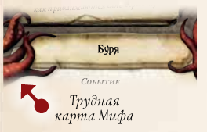
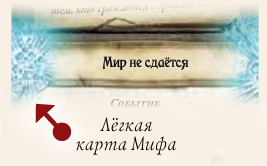
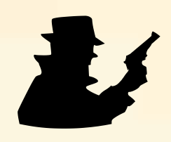
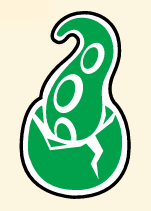
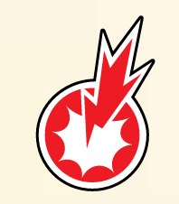

# СПРАВОЧНИК

## ДЛЯ ЧЕГО НУЖНА ЭТА КНИГА

Перед вами справочник по правилам настольной игры «Древний ужас».
Здесь собраны ответы на те вопросы, которые не освещены в правилах игры.
В отличие от книги правил, справочник не учит играть в «Древний ужас».
Новым игрокам сначала следует внимательно прочитать правила, а уже потом, в ходе игры, по необходимости обращаться к справочнику.

**Прочитайте правила игры, прежде чем переходить к справочнику.**
В книге правил вы найдёте всё нужное для того, чтобы начать свою первую игру.
Ответы на вопросы, возникающие в ходе партии, следует искать **в этом справочнике, а не в книге правил.**

В этом справочнике 4 основных раздела:
1. [Глоссарий](#глоссарий). Это основная часть справочника, где вы найдёте подробные разъяснения к правилам. Они сгруппированы по темам в алфавитном порядке.
1. [Ответы на частые вопросы](#ответы-на-частые-вопросы). Здесь собраны ответы на вопросы, которые нередко возникают в ходе игры.
1. [Дополнительные правила](#дополнительные-правила). Здесь рассказано, как изменить сложность игры и вести подсчёт очков.
1. [Справочный лист](#справочный-лист). Краткое описание всех фаз раунда и условных обозначений.

Раздел [«Свойства сыщиков»](investogators.md) находится в другом файле. В нем детально рассмотрены способности сыщиков.

## ЗОЛОТЫЕ ПРАВИЛА

Справочник — наиболее авторитетный свод правил игры.
Если книга правил в чём-то противоречит справочнику, следует поступать так, как сказано в справочнике.

Текст карт и других игровых компонентов иногда противоречит правилам или справочнику.
В таких ситуациях приоритет отдаётся карте (компоненту).

Если эффект запрещает что бы то ни было словами «нельзя» или «не может», данный запрет является безусловным.

## ГЛОССАРИЙ

В этом разделе собрана детальная информация обо всех игровых понятиях.

### БАНКОВСКАЯ ССУДА

- Выполняя действие «Приобретение активов», сыщик может взять состояние «Долг», чтобы немедленно добавить 2 успеха к результату своей проверки.
- Если у сыщика уже есть «Долг», он не может взять банковскую ссуду.

См. также: [Получение имущества и состояний](#получение-имущества-и-состояний), [Приобретение активов](#приобретение-активов), [Резерв](#резерв).

### БЕЗЫСХОДНОСТЬ

- Когда безысходность повышается, жетон безысходности движется на нужное число делений **ближе** к нулевому делению шкалы.
- Когда безысходность снижается, жетон безысходности движется на нужное число делений **дальше** от нулевого деления шкалы.
- Числа на шкале безысходности условно отражают время, оставшееся до пробуждения Древнего.
Когда безысходность повышается, это время сокращается, а когда она снижается, его становится чуть больше.
- Когда жетон безысходности достигает нулевого деления шкалы, Древний пробуждается.
- Если Древний пробудился, безысходность больше не может снижаться.
На листе Древнего сказано, что происходит, если после пробуждения Древнего безысходность повышается.
- Если при повышении безысходности жетон должен перейти за нулевое деление, он останавливается на нулевом делении, Древний немедленно пробуждается, а затем оставшееся повышение безысходности проходит по правилам, изложенным на листе Древнего.

См. также: [Древний](#древний), [Знамение](#знамение).

### БЛИЖАЙШИЙ

Иногда игрокам нужно найти ближайшую локацию, отвечающую тому или иному условию.
Расстояние между локациями определяется числом путей, связывающих эти локации по кратчайшему маршруту.
То же относится к жетонам, сыщикам и т. п.
- Если несколько подходящих локаций находятся на одинаково близком расстоянии, активный сыщик выбирает одну из них.
Если исходная локация отвечает данному условию, она сама считается ближайшей.

См. также: [Локации](#локации), [Пути](#пути).

### Боевые контакты

Если в фазе контактов сыщик находится в локации, где есть один или несколько монстров, он должен вступить в один боевой контакт с каждым из этих монстров: по очереди, в любом порядке на свой выбор.

Боевой контакт проходит следующим образом:
1. **Проверьте свойства монстра:** некоторые свойства монстра могут повлиять на условия боевого контакта.
Обязательно прочитайте все свойства монстра, прежде чем переходить к проверкам.
2. **Пройдите проверку воли:** сыщик проходит проверку, указанную на жетоне монстра.

   - Если **ужас** монстра больше результата проверки, сыщик теряет 1 рассудок за каждую единицу разницы.

3. **Пройдите проверку силы:** сыщик проходит проверку, указанную на жетоне монстра.

   - Если **ущерб** монстра больше результата проверки, сыщик теряет 1 здоровье за каждую единицу разницы.
   - Если проверка пройдена успешно, монстр теряет столько здоровья, сколько успехов выпало.
   Отметьте это, положив нужное число жетонов здоровья на жетон монстра.
   Сыщик и монстр теряют здоровье одновременно.

- Если потерянное монстром здоровье сравнялось с его стойкостью или превысило её, монстр побеждён и возвращается в пул.
- Если на жетоне монстра не указана проверка воли или силы, сыщик не проходит эту проверку.
- Если в фазе контактов сыщик победил всех монстров в своей локации, он может сразу же вступить в другой контакт в этой локации по своему выбору.

См. также: [Монстры](#монстры), [Проверки](#проверки).

### ВЕДУЩИЙ СЫЩИК

- Ведущий сыщик — это игрок, которому в данный момент принадлежит жетон ведущего сыщика.
- Ведущий сыщик первым выполняет свои действия в фазе действий, а также первым вступает в контакт в фазе контактов.
Право совершить действия и вступить в контакт передаётся от ведущего сыщика по часовой стрелке остальным игрокам.
- В фазе Мифа ведущий сыщик разыгрывает карту Мифа.
- В конце фазы Мифа ведущий сыщик может передать жетон ведущего сыщика другому сыщику на свой выбор.
- Когда сыщики принимают решение совместно, последнее слово остаётся за ведущим сыщиком.

См. также: [Противоречия](#противоречия).

### ВРАТА

- Жетоны врат лежат лицом вниз в своей стопке, пока не будут выложены на поле.
- Если врата закрыты, их жетон сбрасывается.
- Когда жетон врат сбрасывается, он кладётся лицом вверх в сброс рядом со стопкой врат. Если в стопке врат не осталось жетонов, перемешайте все сброшенные жетоны врат и сложите их в стопку лицом вниз.
- Когда игровой эффект предписывает открыть врата, возьмите из стопки врат верхний жетон и выложите его в локацию, указанную на лицевой стороне жетона. Затем выложите в эту локацию одного монстра.
- Если вам надо открыть врата, в то время как стопка и сброс врат пусты, вместо этого **повысьте безысходность на 1**.
- В фазе контактов сыщик в локации с открытыми вратами может вступить в контакт в Ином мире, вытянув и разыграв карту из соответствующей колоды.

См. также: [Контакты в Иных мирах](#контакты-в-иных-мирах).

### ВЫбЫВШИЕ ИЗ ИГРЫ

- Если игрок выбыл из игры, он не выбирает себе нового сыщика.
- Если побеждённый игрок не может выбрать себе нового сыщика, поскольку свободных сыщиков не осталось, этот игрок выбывает из игры.
- Если сыщик побеждён или сожран после пробуждения Древнего, этот игрок выбывает из игры.
- Если сыщики побеждают, выбывшие игроки тоже считаются победителями.
- Если все игроки выбыли из игры, сыщики проиграли.

См. также: [Победа и поражение](#победа-и-поражение).

### ДВУСТОРОННИЕ КАРТЫ

- Двусторонние карты одного и того же типа отличаются не только лицевой стороной, но и рубашкой.
Тип двусторонней карты указан под её названием.
- Колоды двусторонних карт лежат лицом вверх.
Сыщики могут смотреть на лицевую сторону верхней карты в каждой такой колоде.
- Когда сыщик берёт случайную карту из колоды двусторонних карт, он тянет нижнюю карту.
- Когда двусторонняя карта сбрасывается, она сразу же затасовывается обратно в свою колоду.
- После того как игрок перетасовал колоду двусторонних карт, другой игрок сдвигает её.

### ДЕЙСТВИЯ

Во время фазы действий каждый сыщик может выполнить до двух действий.
Ведущий сыщик выполняет свои действия первым, затем свои действия совершает его сосед слева и далее по часовой стрелке.
- Каждый сыщик может выполнить каждое действие только один раз за раунд.
- Если сыщик не может или не хочет совершать действия, он вправе этого не делать.
- Сыщик должен выполнить действие до конца, прежде чем начинать другое действие.
Например, он не может прервать путешествие, чтобы совершить обмен, а затем продолжить движение.

См. также: [Ведущий сыщик](#ведущий-сыщик), [Задержанные сыщики](#задержанные-сыщики), [Местное действие](#местное-действие), [Обмен](#обмен), [Особое действие](#особое-действие), [Отдых](#отдых), [Подготовка](#подготовка-к-путешествию), [Приобретение активов](#приобретение-активов), [Путешествие](#путешествие).

### ДРЕВНИЙ

- Во время подготовки игроки выбирают Древнего, против которого им предстоит играть до конца партии.
- На рубашке карт тайн, особых и поисковых контактов изображён соответствующий им Древний.
- Игровые эффекты Древнего могут потребовать отложить жетоны монстров или иные компоненты.
- На листе Древнего указана информация о культистах.
- Если Древний пробудился, переверните его лист и разыграйте эффекты пробуждения, если таковые имеются.
- После того как лист перевёрнут, вместо эффектов с его лицевой стороны действуют эффекты с его обратной стороны.
- Если Древний пробудился, сыщики, помимо других тайн, должны разгадать последнюю тайну, описанную на обороте листа Древнего.
- Сыщик выбывает из игры, если он был побеждён или сожран после пробуждения Древнего.

См. также: [Безысходность](#безысходность), [Культисты](#культисты), [Мифы](#мифы), [Особые контакты](#особые-контакты), [Отложенные компоненты](#отложенные-компоненты), [Поисковые контакты](#поисковые-контакты), [Тайны](#тайны)

### ЖЕТОНЫ ДРЕВНИХ

- Жетоны Древних — универсальный игровой элемент, который используется при розыгрыше многих эффектов, в том числе свойств Древнего.
- В тексте карты (или иного компонента), предписывающей выложить на поле жетон Древних, сказано, каким образом сыщики взаимодействуют с этим жетоном.
- Жетон Древних на игровом поле позволяет сыщику вступить в контакт только в том случае, если это сказано в тексте карты (или иного компонента), которая ввела в игру данный жетон.

### ЗАДЕРЖАННЫЕ СЫЩИКИ

Если сыщик задержан, положите его фишку набок.
- Задержанный сыщик не может выполнять никаких действий.
- Если сыщик задержан во время своей фазы действий, он немедленно заканчивает своё текущее действие, теряет все оставшиеся действия и завершает свой ход, **вместо того чтобы стать задержанным**.
- В фазе действий, вместо того чтобы выполнять действия, задержанный сыщик возвращает свою фишку в вертикальное положение и больше не считается задержанным.

### ЗАКЛИНАНИЯ

- Карты заклинаний двусторонние.
Сыщик **не может смотреть обратную сторону заклинания**, пока эффект не позволит это сделать.
- На карте заклинания описано, каким образом сыщик может его прочитать — иными словами, разыграть его эффект.
Одни заклинания требуют потратить на это действие, другие можно прочитать при выполнении определённых условий.
- Когда сыщик читает заклинание, он выполняет то, что описано на лицевой стороне карты.
Как правило, при этом от него требуется пройти проверку и/или перевернуть карту.
- Сыщик может владеть только одним экземпляром каждого заклинания.
Если сыщик по какой-либо причине получает дубликат заклинания, он сбрасывает новую карту.

См. также: [Двусторонние карты](#двусторонние-карты), [Переворачивание карт и листов](#переворачивание-карт-и-листов), [Подтипы](#подтипы), [Получение имущества и состояний](#получение-имущества-и-состояний).

### ЗАСАДА

Когда монстр нападает из засады, вслепую вытяните из пула одного монстра.
Затем сыщик немедленно вступает в боевой контакт с этим монстром.
- Монстр, напавший из засады, не выкладывается на поле, и его эффект вторжения (текст «Когда этот монстр выкладывается на поле»), если он есть, не разыгрывается.
- По окончании боевого контакта монстр сбрасывается, даже если не был побеждён.
- Если из засады нападает **определённый** монстр (названный по имени), не вытягивайте жетон из пула.
Вместо этого используйте информацию о свойствах данного монстра с отложенного жетона или с жетона, лежащего на поле.
- Если из засады нападает культист, не вытягивайте жетон из пула.
Вместо этого используйте информацию о свойствах культиста с листа Древнего.
- В отличие от обычного боевого контакта, если монстр нападает из засады и сыщик побеждает его, игрок не может сразу же вступить в другой контакт.

См. также: [Боевые контакты](#боевые-контакты), [Культисты](#культисты), [Отложенные компоненты](#отложенные-компоненты).

### ЗДОРОВЬЕ И РАССУДОК

- На листе каждого сыщика указаны максимальные значения его здоровья и рассудка.
В начале игры здоровье и рассудок сыщика равны соответствующим максимальным значениям.
- Здоровье и рассудок сыщика не могут подняться выше соответствующих максимальных значений.
- Жетон здоровья (рассудка) с цифрой «3» равноценен трём обычным жетонам здоровья (рассудка).
Игроки могут в любое время обменять жетон с цифрой «3» на три обычных жетона или наоборот.
- Когда сыщик теряет здоровье или рассудок, он возвращает в банк нужное количество жетонов здоровья и рассудка.
- Если текущее здоровье или рассудок сыщика падает до нуля, сыщик побеждён.
- Эффекты, которые предотвращают потерю здоровья или рассудка, не срабатывают, когда сыщик **тратит** здоровье или рассудок.
- Сыщик не может потратить здоровье или рассудок, если в результате этого будет побеждён (иными словами, сыщик не может потратить своё последнее здоровье или рассудок).

См. также: [Побеждённые сыщики](#побеждённые-сыщики), [Тратить](#тратить).

### ЗНАМЕНИЕ

- Текущее знамение — это символ на том делении круга знамений, где находится жетон знамений.
- Чтобы изменить знамение, передвиньте жетон по кругу знамений на указанное число делений по часовой стрелке.
Всякий раз, когда жетон оказывается на очередном делении круга, повышайте безыходность на 1 за каждые открытые врата с таким же символом, как на этом делении.

См. также: [Безысходность](#безысходность).

### ИМУЩЕСТВО

- Имущество сыщика включает в себя его улики, билеты, активы, артефакты и заклинания.
- Многие активы, артефакты и заклинания позволяют своему владельцу совершать особые действия, описанные в тексте этих карт.
- Если в описании свойства не сказано, сколько раз его можно применить, таким свойством можно воспользоваться только один раз при каждом возникновении необходимых условий. Например, если актив позволяет сыщику восстанавливать 1 дополнительное здоровье при отдыхе, сыщик может делать это только один раз за отдых.

См. также: [Обмен](#обмен), [Особое действие](#особое-действие), [Получение имущества и состояний](#получение-имущества-и-состояний).

### КОНТАКТЫ

В фазе контактов каждый сыщик должен вступить в один контакт. Сыщики вступают в контакты по очереди, начиная с ведущего сыщика и далее по часовой стрелке.
- Если сыщик находится в локации, где есть один или несколько монстров, он **должен** вступить в один боевой контакт с каждым из этих монстров: по очереди, в любом порядке на свой выбор.
- Если в фазе контактов после боевого контакта в локации сыщика не осталось монстров, он может сразу же вступить в другой контакт по своему выбору.
- Если сыщик может выбирать из нескольких контактов, он вступает в один из них по своему выбору.
- Если у сыщика есть состояние «Заключение», вместо контакта по обычным правилам он должен сделать то, что сказано на обратной стороне этой карты, — **даже** если в его локации есть монстр.

См. также: [Боевые контакты](#боевые-контакты), [Контакты в Иных мирах](#контакты-в-иных-мирах), [Контакты в локациях](#контакты-в-локациях), [Особые контакты](#особые-контакты), [Побеждённые сыщики](#побеждённые-сыщики), [Поисковые контакты](#поисковые-контакты), [Слухи](#слухи), [Составные контакты](#составные-контакты), [Экспедиционные контакты](#экспедиционные-контакты).

### КОНТАКТЫ В ИНЫХ МИРАХ

Если в фазе контактов сыщик находится в локации с открытыми вратами, он может вступить в контакт в Ином мире, вытянув и разыграв карту из соответствующей колоды.
- Контакты в Иных мирах — это составные контакты, которые могут потребовать от сыщика пройти несколько проверок.
- Когда в тексте контакта говорится «эти врата», имеются в виду те врата, где сыщик вступил в контакт.
- Когда сыщик разыгрывает контакт в Ином мире, считается, что он по-прежнему находится на поле в своей текущей локации.

См. также: [Врата](#врата), [Составные контакты](#составные-контакты).

### КОНТАКТЫ В ЛОКАЦИЯХ

- В фазе контактов сыщик может вступить в контакт в своей локации.
Для этого он тянет карту общего контакта и разыгрывает контакт для того типа локации, где он находится (город, глушь или море).
- Если в фазе контактов сыщик находится в Аркхэме, Буэнос-Айресе или Сан-Франциско, вместо общего контакта он может вытянуть карту контакта в Америке и разыграть контакт для соответствующего города.
- Если в фазе контактов сыщик находится в Стамбуле, Лондоне или Риме, вместо общего контакта он может вытянуть карту контакта в Европе и разыграть контакт для соответствующего города.
- Если в фазе контактов сыщик находится в Шанхае, Сиднее или Токио, вместо общего контакта он может вытянуть карту контакта в Азии и Австралии и разыграть контакт для соответствующего города.
- На игровом поле под названием каждого из девяти перечисленных городов сказано, что чаще всего получает сыщик от успешно разыгранного контакта в этой локации.

См. также: [Локации](#локации).

### КУЛЬТИСТЫ

- На обороте жетона культиста, в отличие от большинства монстров, нет никакой информации.
- Когда сыщик вступает в боевой контакт с культистом, игрок берёт информацию о культистах с листа Древнего.
Эта информация включает в себя проверку *воли*, проверку *силы*, ужас, ущерб, стойкость и текстовые эффекты.
- У всех культистов на лицевой стороне жетона есть символы *эффект вторжения* и *Расплаты*.
Эти символы напоминают, что игрокам следует сверяться с листом Древнего, когда они выкладывают культистов на поле и когда разыгрывается эффект расплаты, на случай, если в информации о культистах есть соответствующее свойство.

### ЛОКАЦИИ

- Каждая локация относится к одному из трёх типов: город, глушь или море.
Символы этих типов указаны в условных знаках на игровом поле.
- Каждая локация связана путём хотя бы с одной соседней локацией.

См. также: [Путешествие](#путешествие), [Пути](#пути), [Соседние локации](#соседние-локации).

### МЕСТНОЕ ДЕЙСТВИЕ

Некоторые действия на картах имущества и состояний отмечены словами «Местное действие».
- Сыщик может выполнять местные действия своих карт имущества и состояний.
- Кроме того, сыщик может выполнять местные действия чужих карт, если он находится в одной локации с их владельцем.
- Сыщик может выполнить каждое местное действие только один раз за раунд.
Разные сыщики вправе выполнять одно и то же местное действие (по разу каждый) в течение одной фазы действий.

См. также: [Локации](#локации).

### МИФЫ

- Если колода Мифов пуста, новая колода из сброса **не формируется**.
Вместо этого, если сыщики должны вытянуть карту Мифа из пустой колоды, фаза Мифа заканчивается и сыщики проигрывают.
- Разыграв карту **_процесса_**, выложите её возле листа Древнего. Такая карта остаётся в игре, пока не будет сброшена.
- Символ в правом нижнем углу карты Мифа служит напоминанием о том, что у карты есть эффект расплаты.
Такой символ **не требует** разыграть эффекты расплаты (в отличие от аналогичного символа в верхней части карты Мифа).
- Разыгрывая карту Мифа, вы должны выполнить все её инструкции так полно, как это возможно.
Если карта Мифа требует разыграть ещё одну карту Мифа, вы должны в полной мере выполнить инструкции и этой новой карты.

См. также: [Врата](#врата), [Знамение](#знамение), [Наплыв монстров](#наплыв-монстров), [Памятка](#памятка), [Победа и поражение](#победа-и-поражение), [Подтипы](#подтипы), [Расплата](#расплата), [Символы на картах Мифов](#символы-на-картах-мифов), [Улики](#улики).

### МОНСТРЫ

- Монстры, которые не выложены на поле и не отложены, хранятся в пуле монстров.
- Когда игровой эффект предписывает выложить монстра на поле, вытяните из пула один жетон монстра и выложите его в локацию, указанную эффектом.
- Если на лицевой стороне жетона есть символ вторжения, то, выкладывая этого монстра на поле, выполните то, что сказано на обратной стороне жетона после слов «Когда этот монстр выкладывается на поле».
- Если в фазе контактов сыщик находится в локации с монстром, он должен вступить с этим монстром в боевой контакт.
- Если потерянное монстром здоровье сравнялось с его стойкостью или превысило её, монстр побеждён.
- Когда монстр побеждён или сброшен, верните его в пул монстров и перемешайте жетоны в пуле.
- Термин «монстр» относится как к обычным монстрам, так и к эпическим. Термин «не эпический монстр» относится **только** к обычным монстрам.

См. также: [Боевые контакты](#боевые-контакты), [Отложенные компоненты](#отложенные-компоненты), [Эпические монстры](#эпические-монстры).

### НАВЫКИ

- На листе каждого сыщика указаны пять навыков:
    1. **ЗНАНИЯ:** нужны для чтения заклинаний и часто требуются в ходе контактов в Иных Мирах;
    1. **ОБЩЕНИЕ:** нужно для приобретения активов и часто требуется в ходе общих контактов в городах и контактов с побеждёнными сыщиками;
    1. **ВНИМАНИЕ:** часто требуется в ходе поисковых и экспедиционных контактов;
    1. **CИЛА:** часто требуется в ходе боевых и экспедиционных контактов;
    1. **ВОЛЯ:** часто требуется в ходе боевых контактов и контактов в Иных мирах.

- Значение навыка — это базовое число кубиков (без учёта модификаторов), которое сыщик бросает при проверке данного навыка.

См. также: [Проверки](#проверки), [Улучшение навыков](#улучшение-навыков).

### НАПЛЫВ МОНСТРОВ

- Чтобы разыграть наплыв монстров, выложите в нужную локацию столько монстров, сколько указано в памятке (зависит от числа игроков):
    - **1–2 игрока** — 1 монстра;
    - **3–6 игроков** — 2 монстров;
    - **7–8 игроков** — 3 монстров.

- Если на карте Мифа есть символ наплыва монстров, разыграйте наплыв монстров в каждой локации, где открыты врата с таким же символом, как текущее знамение.
Если подходящих врат на поле нет, вместо этого откройте 1 врата.

См. также: [Мифы](#мифы), [Монстры](#монстры).

### ОБМЕН

В качестве действия сыщик может обменяться любым своим имуществом с другим сыщиком в той же локации.
Эти два сыщика могут свободно передавать друг другу имущество в любом количестве, пока оба согласны на обмен.
- Не подлежат обмену состояния, жетоны здоровья, рассудка и улучшений.
- Нельзя обмениваться с побеждёнными сыщиками.

См. также: [Имущество](#имущество).

### ОГРАНИЧЕНИЯ НА КОМПОНЕНТЫ

- Сыщик может взять карту или получить жетон, только если они доступны.
    - Карта считается доступной, если она лежит в колоде, в сбросе или в резерве.
    - Карты и жетоны на листе побеждённого сыщика не считаются доступными.

- Если в банке и сбросе нет улик, невозможно получить улику или выложить её на поле.
- Если вам надо открыть врата, в то время как стопка и сброс врат пусты, вместо этого **повысьте безысходность на 1**.
- Если пул монстров пуст, невозможно выложить монстра на поле.
Также невозможно выложить на поле отложенного монстра, если все отложенные монстры нужного вида уже на поле.
- За исключением улик, врат и монстров, все остальные жетоны доступны всегда.
Если в банке не осталось нужных жетонов, замените их чем-нибудь (например, монетами) или записывайте их количество на бумаге.
- Если карты в колоде закончились, сразу же перетасуйте соответствующую стопку сброса и используйте её как новую колоду.
Не пополняется таким образом только колода Мифов.

См. также: [Отложенные компоненты](#отложенные-компоненты), [Сброс](#сброс).

### ОКРУГЛЕНИЕ

В любой игровой ситуации, когда вам надо определить половину числа, округляйте вверх.

### ОСОБОЕ ДЕЙСТВИЕ

Многие игровые компоненты (такие как лист сыщика, состояния, имущество) дают сыщику возможность в фазе действий совершить указанные на них особые действия.
- Как и остальные действия, особое действие каждого компонента можно выполнить только один раз за раунд.
Если кто-то выполнил особое действие компонента, до конца раунда никто, даже другой сыщик, **не может** ещё раз выполнить действие того же компонента (исключение — местные действия).
Например, если сыщик выполнил особое действие карты актива и затем передал её коллеге, новый владелец не может выполнить действие этого актива в том же раунде.
- Действие, указанное на листе сыщика, может выполнить только этот сыщик.
- Действие, указанное на имуществе или состоянии, может выполнить только тот, кто владеет данной картой.
- У некоторых компонентов есть местные действия, которые могут выполнять любые сыщики в той же локации, что и владелец компонента.

См. также: [Имущество](#имущество), [Местные действия](#местные-действия).

### ОСОБЫЕ КОНТАКТЫ

Особые контакты — это уникальные контакты, связанные с тем или иным Древним. Как правило, сыщики вступают в эти контакты, чтобы разгадать определённую тайну (или последнюю тайну).
- Особые контакты называются так же, как тайна (или последняя тайна), в рамках которой они разыгрываются.
На рубашке карты особого контакта изображён Древний, к которому она относится.
Кроме того, там находится иллюстрация соответствующей тайны (или последней тайны).
- На листе Древнего или на карте соответствующей тайны сказано, каким образом сыщики могут вступить в особый контакт и разыграть его.

См. также: [Древний](#древний), [Составные контакты](#составные-контакты), [Тайны](#тайны).

### ОТДЫХ

В качестве действия сыщик восстанавливает 1 здоровье и 1 рассудок.
- Сыщик не может выполнить это действие, если в его локации есть хотя бы один монстр.

### ОТЛОЖЕННЫЕ КОМПОНЕНТЫ

- При подготовке игроки могут получить инструкции отложить определённые компоненты.
Положите такие компоненты возле листа Древнего.
- Разделите отложенные карты по рубашкам, перетасуйте каждую колоду и положите лицом вниз рядом с листом Древнего.
- Когда компонент, который был отложен в ходе подготовки, сбрасывается, он не возвращается в колоду или в пул (как другие аналогичные компоненты), а вместо этого снова откладывается.
- Отложенные компоненты участвуют в игре только тогда, когда игровой эффект требует использовать именно их.
Например, отложенный монстр выкладывается на поле не иначе как под воздействием эффекта, который требует выложить именно этого монстра.

См. также: [Древний](#древний), [Засада](#засада).

### ПАМЯТКА

- В ходе подготовки к игре положите рядом с полем памятку, соответствующую числу игроков.
- На памятке указано, сколько улик выкладывается на поле, сколько врат открывается и сколько монстров появляется из каждых врат в результате соответствующих эффектов карты Мифа.

См. также: [Врата](#врата), [Наплыв монстров](#наплыв-монстров), [Мифы](#мифы), [Улики](#улики).

### ПЕРЕБРОС

- Перебросив кубик, вы должны использовать новый результат, даже если он хуже прежнего.
- Если несколько свойств позволяют сыщику перебросить кубик, он может использовать каждую такую возможность по отдельности.
Кубики можно перебрасывать сколько угодно раз, пока сыщик не исчерпает все свои возможности делать это.
- Большинство свойств, позволяющих перебрасывать кубики (в том числе улики), разрешают делать это только в ходе **проверок навыков**.
Такими свойствами нельзя воспользоваться во время других бросков, например разыгрывая эффект расплаты карты «Благословение».

### ПЕРЕВОРАЧИВАНИЕ КАРТ И ЛИСТОВ

- Когда карта или лист переворачиваются обратной стороной вверх, сразу же выполните то, что сказано на их обороте (за исключением эффектов, которые срабатывают в особых условиях, таких как эффект расплаты).
- Когда карта или лист вновь переворачиваются лицевой стороной вверх, не выполняйте то, что сказано на их лицевой стороне.

### ПОБЕДА И ПОРАЖЕНИЕ

Если разыгрывается эффект с текстом «сыщики побеждают» или «сыщики проиграли», игра немедленно заканчивается.
- В тех редких случаях, когда оба эти эффекта разыгрываются одновременно, сыщики побеждают.
- Сыщики побеждают, разгадав нужное число тайн.
- Если все игроки выбыли из игры, сыщики проигрывают.
- Если в фазе Мифа игроки не могут вытянуть карту Мифа, фаза Мифа немедленно заканчивается и сыщики проигрывают.
- Если жетон безысходности достигает нулевого деления шкалы безысходности, Древний пробуждается.
Лист Древнего переворачивается, и на его обороте указано, каким образом сыщики могут проиграть.

См. также: [Выбывшие из игры](#выбывшие-из-игры), [Древний](#древний), [Мифы](#мифы), [Тайны](#тайны).

### ПОБЕЖДЁННЫЕ СЫЩИКИ

Как только сыщик теряет всё своё здоровье или весь свой рассудок, он сразу же побеждён и должен сделать следующее:
1. **Повышение безысходности:** сыщик повышает безысходность на 1.
2. **Перемещение:** сыщик перемещает свою фишку в ближайший город.
Затем он кладёт фишку набок и помещает на неё жетон здоровья, если сыщик потерял всё своё здоровье, или жетон рассудка, если сыщик лишился всего своего рассудка.
3. **Сбор имущества:** сыщик сбрасывает все свои карты состояний, а также жетоны здоровья, рассудка и улучшений, после чего помещает всё своё имущество на свой лист сыщика и откладывает его в сторону.
4. **Потеря лидерства:** если у побеждённого сыщика был жетон ведущего сыщика, он передаёт его любому сыщику на свой выбор.

#### ПОБЕЖДЁННЫЕ СЫЩИКИ: ДРУГИЕ ПРАВИЛА

- Если сыщик полностью лишился **и здоровья**, **и рассудка**, он сам выбирает, какой жетон положить на свой лист: здоровья или рассудка.
- Если его сыщик был побеждён, в конце фазы Мифа игрок выбирает себе нового сыщика.
Нельзя выбрать сыщика, который уже был побеждён в этой партии.
Если свободных сыщиков не осталось, игрок выбывает из игры.
- Если сыщик побеждён после пробуждения Древнего, этот игрок выбывает из игры.
- Побеждённый сыщик не считается сыщиком: он не может выполнять действия или разыгрывать эффекты, на него не влияют никакие эффекты.
- Если сыщик побеждён в ходе своего контакта или действия, он немедленно прекращает разыгрывать этот контакт или действие.
- В фазе контактов сыщик в локации, где лежит фишка побеждённого сыщика, может вступить в контакт, описанный на обороте листа побеждённого сыщика.
Если на фишке побеждённого сыщика лежит жетон здоровья, сыщик разыгрывает контакт в случае инвалидности или смерти, а если жетон рассудка — контакт в случае душевного расстройства.

См. также: [Выбывшие из игры](#выбывшие-из-игры), [Здоровье и рассудок](#здоровье-и-рассудок).

### ПОДГОТОВКА К ПУТЕШЕСТВИЮ

В качестве действия сыщик, находящийся в городе, получает один билет.
- Если он находится в городе, к которому ведёт хотя бы один путь поезда, сыщик может получить один билет на поезд.
- Если он находится в городе, к которому ведёт хотя бы один путь корабля, сыщик может получить один билет на корабль.
- У сыщика не может быть более двух билетов. Если сыщик выполняет это действие, когда у него уже есть два билета, он может сбросить один из них, прежде чем получить новый.

См. также: [Путешествие](#путешествие).

### ПОДТИПЫ

- Карты артефактов, активов, состояний, заклинаний и Мифов обладают подтипами.
- Подтип карты указан в верхней части её текста полужирным курсивом (например, **_оружие_** ).
- Сами по себе подтипы не обладают никакими особыми эффектами.
- Ссылка на подтип может содержаться в тексте эффекта: например, «возьмите состояние- **_безумие_** ».

### ПОИСК КАРТ

- Когда сыщик ищет карту, соответствующую определённым критериям, он просматривает колоду снизу вверх, пока не найдёт нужную карту.
- Если сыщик не нашёл в колоде подходящую карту, он ищет её в соответствующей стопке сброса.
- Просмотрев колоду, сыщик должен её перетасовать.

См. также: [Получение имущества и состояний](#получение-имущества-и-состояний).

### ПОИСКОВЫЕ КОНТАКТЫ

- Если в фазе контактов сыщик находится в локации с уликой, он может вступить в поисковый контакт, вытянув и разыграв карту из соответствующей колоды.
- На рубашке карты поискового контакта изображён Древний, к которому она относится.
- Когда в тексте поискового контакта говорится «эта улика», имеется в виду улика, вызвавшая контакт.
- Если улика, вызвавшая контакт, не взята и не сброшена, она остаётся в своей локации и может снова вызвать контакт.
- Если поисковый контакт упоминает дополнительные улики, имеются в виду улики в банке.

См. также: [Древний](#древний), [Улики](#улики).

### ПОЛУЧЕНИЕ ИМУЩЕСТВА И СОСТОЯНИЙ

- **Получение случайной карты:** когда сыщику нужно просто взять карту (например, «возьмите 1 артефакт»), он берёт верхнюю карту из соответствующей колоды.
    - Если сыщику попадается заклинание или состояние, которое у него уже есть, он сбрасывает его и берёт карту снова. Это повторяется, пока сыщик не вытянет карту, которой у него ещё нет (если это возможно).
    - Двусторонние карты берутся снизу колоды.

- **Получение карты определённого подтипа:** когда сыщику нужно взять карту того или иного подтипа (например, «возьмите состояние-**_безумие_** »), он просматривает в поисках подходящей карты сначала соответствующую колоду, а затем её стопку сброса, берёт себе первую попавшуюся карту нужного подтипа, а затем тасует колоду.
    - Когда сыщик получает таким образом заклинание или состояние, он просматривает колоду, пока ему не попадётся подходящая карта, которой у него ещё нет, и берёт её.

- **Получение определённой карты:** когда сыщику нужно взять конкретную карту (например, «возьмите актив „Топор“»), он просматривает в поисках подходящей карты сначала соответствующую колоду, а затем её стопку сброса, берёт себе первую попавшуюся карту с нужным названием, а затем тасует колоду.
    - Если нужная карта лежит в резерве, сыщик просто берёт эту карту вместо того, чтобы просматривать колоду.
    - Если сыщик не может найти нужную карту, он не получает её.
    Такая ситуация может сложиться, если все экземпляры этой карты находятся у других сыщиков, у побеждённых сыщиков или убраны в коробку.

- **Получение карты из резерва:** когда сыщику нужно взять карту, в том числе определённого подтипа, из резерва (например, «возьмите 1 актив- **_союзника_** из резерва»), он берёт из резерва одну подходящую карту **на свой выбор**.
- **Получение улик:** когда сыщику нужно получить улику, он вслепую берёт один жетон улики из банка и кладёт его возле своего листа сыщика.
Если же карта поискового контакта предписывает сыщику «получить эту улику», он забирает улику из той локации, где находится.

См. также: [Двусторонние карты](#двусторонние-карты), [Имущество](#имущество), [Поиск](#поиск-карт).

### ПРИОБРЕТЕНИЕ АКТИВОВ

В качестве действия сыщик, находящийся в городе, проходит проверку общения.
Затем он может взять из резерва сколько угодно карт, общая цена которых не превышает результата проверки (числа выпавших успехов).
- Если сыщик не может или не хочет брать карты из резерва, он может вместо этого сбросить из резерва одну карту по своему выбору.
- Сыщик не может выполнить это действие, если в его локации есть хотя бы один монстр.

См. также: [Банковская ссуда](#банковская-ссуда), [Проверки](#проверки), [Резерв](#резерв).

### ПРОВЕРКИ

Когда сыщику надо пройти проверку, он делает следующее:
1. **Определение числа кубиков:** сыщик подсчитывает, сколько кубиков он будет бросать.
   - Сыщик берёт за основу указанное на его листе значение проверяемого навыка.
   - Затем он добавляет к этому значению или вычитает из него модификатор проверки (указанный вслед за символом навыка в описании проверки).
   - Если у него есть жетон улучшения проверяемого навыка, сыщик добавляет бонус от этого жетона.
   - Сыщик может использовать **одно** свойство, дающее бонус к нужному навыку (например, «получите +3 воли»).
   Если сыщику доступно несколько таких свойств, он учитывает только самый большой бонус.
   - Сыщик добавляет все дополнительные кубики, которые он может бросить в этой проверке.
   В отличие от бонусов, дополнительные кубики от разных свойств суммируются.

2. **Бросок кубиков:** сыщик бросает полученное число кубиков.
   - Если он должен бросить меньше одного кубика, сыщик всё равно бросает 1 кубик.
   - Если он должен бросить больше кубиков, чем имеется в наличии, сыщик бросает все имеющиеся кубики, подсчитывает успехи, затем бросает кубики снова, пока не сделает нужное число бросков.

3. **Определение результата:** каждая выпавшая «5» или «6» — это один **успех**.
Общее количество выпавших успехов — это **результат проверки**.
Если выпал хотя бы один успех, проверка считается пройденной **успешно**.
Если успехов не выпало, проверка завершается **провалом**.
4. **Последствия успеха или провала:** в тексте, потребовавшем пройти проверку, сказано, что надо сделать в случае успешного или провального результата.

- Иногда в тексте указаны последствия только одного исхода проверки — успеха или провала.
Если сыщик успешно прошёл проверку, для которой нет последствий успеха, ничего не происходит.
Аналогично, если сыщик провалил проверку, для которой нет последствий провала, он не подвергается вредным воздействиям.
- В тексте контактов проверки обозначены символами навыков, взятыми в скобки.
После символа может быть указан модификатор проверки.
- Эффекты, которые зависят от исхода проверки, всегда начинаются со слов «при успехе» или «при провале».
Всё, что описано в таком предложении, происходит только в том случае, если сыщик успешно прошёл проверку или провалил её соответственно.
Эффекты, описанные в дальнейших предложениях и абзацах текста, от исхода проверки не зависят.

См. также: [Навыки](#навыки).

### ПРОТИВОРЕЧИЯ

- Если несколько эффектов должны сработать одновременно, порядок их розыгрыша выбирает активный игрок.
- Когда сыщики принимают решение совместно, последнее слово остаётся за ведущим сыщиком.
- Всегда следуйте тексту карты, даже если он противоречит правилам.
- Если карта запрещает что-то делать, этот запрет безусловен.
Например, на карте состояния «Заключение» сказано: «Вы **не можете** двигаться».
Это значит, что сыщик не может двигаться ни сам, ни под воздействием чего бы то ни было.

### ПУТЕШЕСТВИЕ

В качестве действия сыщик перемещается из своей локации в любую соседнюю.
После этого он может потратить сколько угодно билетов, чтобы переместиться ещё на одну локацию по пути поезда или корабля за каждый потраченный билет на соответствующий вид транспорта.

См. также: [Локации](#локации), [Подготовка к путешествию](#подготовка-к-путешествию), [Пути](#пути), [Соседние локации](#соседние-локации).

### ПУТИ

Каждый путь соединяет две соседние локации и относится к одному из трёх типов: поезд, корабль или тропа.
Символы этих типов указаны в условных знаках на игровом поле.

См. также: [Локации](#локации), [Путешествие](#путешествие), [Соседние локации](#соседние-локации).

### РАСПЛАТА

Эффекты расплаты разыгрываются в следующем порядке:
1. **Монстры:** разыграйте эффекты расплаты каждого монстра с символом расплаты, который находится на игровом поле.
2. **Древний:** разыграйте эффект расплаты с листа Древнего, если там есть такой эффект.
3. **Карты Мифов:** разыграйте эффекты расплаты на каждой карте **_процесса_** в игре.
4. **Имущество и состояния:** начиная с ведущего сыщика и далее по часовой стрелке, каждый сыщик разыгрывает эффекты расплаты всех своих карт имущества и состояний (в любом порядке по своему выбору).

- Эффекты расплаты отмечены символом расплаты.
- Символ в правом нижнем углу карты, листа или жетона служит напоминанием того, что у этого компонента есть эффект расплаты.
- Если в результате розыгрыша эффекта расплаты на поле появляется монстр или сыщик получает какой-либо компонент, не разыгрывайте эффект расплаты этого нового монстра или компонента.

### РЕЗЕРВ

- При подготовке к игре в резерв лицом вверх выкладывается 4 карты активов.
- Выполняя действие «Приобретение активов», сыщики могут брать карты из резерва.
- Всякий раз, когда карта из резерва взята или сброшена, активный сыщик выкладывает на освободившееся место верхнюю карту из колоды активов лицом вверх.
Приобретая активы, активный сыщик не выкладывает в резерв новые карты, пока не завершит действие.

См. также: [Приобретение активов](#приобретение-активов).

### СБРОС

- Сыщик может сбрасывать только своё имущество и свои состояния.
- Когда игровой эффект предписывает сбросить жетон с поля, это делает активный игрок.
- Когда сбрасывается карта, она кладётся лицом вверх в стопку сброса рядом со своей колодой.
- Когда сбрасываются двусторонние карты, такие как заклинания или состояния, они сразу же затасовываются в свои колоды.
- Когда сыщик ищет определённую карту и не находит её в колоде, он продолжает искать её в соответствующей стопке сброса.
- Если карты в колоде закончились, сразу же перетасуйте соответствующую стопку сброса и используйте её как новую колоду.
Не пополняется таким образом только колода Мифов.
- Когда сбрасываются улики, они кладутся лицом вверх в сброс возле банка улик, пока тот не опустеет.
Когда в банке не останется улик, сложите в него все улики из сброса лицом вниз и перемешайте.
- Когда сбрасываются врата, они кладутся лицом вверх в сброс возле стопки врат, пока та не опустеет.
Когда в стопке не останется врат, сложите в неё все врата из сброса лицом вниз и перемешайте.
- Когда сбрасываются монстры, они возвращаются в пул и перемешиваются с остальными монстрами.
- Монстры, отложенные при подготовке к игре, никогда не возвращаются в пул.
Вместо этого при сбросе они снова откладываются.
- Когда сбрасываются жетоны остальных типов, они возвращаются в банк жетонов.
- Если сыщик должен сбросить определённое число компонентов, а у него нет нужного количества данных компонентов, сыщик просто сбрасывает все свои компоненты данного типа.
- Нельзя сбросить с поля то, чего на нём нет.
Если эффект предписывает сыщикам сбросить определённое число компонентов с поля, а на поле нет нужного количества данных компонентов, сыщики просто сбрасывают все оставшиеся компоненты данного типа.

См. также: [Двусторонние карты](#двусторонние-карты), [Отложенные компоненты](#отложенные-компоненты).

### СКРЫТАЯ ИНФОРМАЦИЯ

Часть игровой информации преднамеренно скрыта от игроков.
Без особого разрешения игроки не могут смотреть следующее:
- обратную сторону двусторонних карт, таких как заклинания или состояния;
- порядок и состав карт в любой колоде;
- лицевую сторону улик в банке и врат в стопке;
- карты Мифов, убранные в коробку.

К открытой информации относятся:
- обратная сторона жетонов монстров;
- карты в стопках сброса;
- обратная сторона листов сыщиков;
- обратная сторона листов Древних;
- лицевая сторона улик, которые находятся в сбросе или у сыщика.

Хотя правила не запрещают игрокам знакомиться с открытой информацией, игра станет более интересной, если они будут делать это только, получив соответствующее указание.
Кроме того, мы советуем, чтобы активный сыщик, зачитывая текст контакта, не раскрывал другим игрокам последствия успеха или провала проверки, пока не пройдёт её.

### СЛУХИ

- Жетоны слухов выкладываются на поле по указанию карт Мифов.
- Если в фазе контактов сыщик находится в локации с жетоном слуха, он может вступить в контакт, описанный на карте Мифа, которая вызвала этот слух.
- Когда слух прекращён, сбросьте карту этого слуха, все жетоны с неё, а также соответствующий жетон слуха с поля.

См. также: [Мифы](#мифы), [Подтипы](#подтипы).

### СЛУЧАЙНЫЕ ЛОКАЦИИ

Чтобы определить случайную локацию, сбросьте из банка улик один жетон и посмотрите, какая локация указана на его лицевой стороне.
- Если ни в банке, ни в сбросе улик не осталось, локацию выбирает ведущий сыщик.

### СОЖРАННЫЕ СЫЩИКИ

Когда сыщик сожран, он должен сделать следующее:
1. **Повышение безысходности:** сыщик повышает безысходность на 1.
2. **Сброс имущества:** сыщик сбрасывает всё свое имущество, карты состояний, а также жетоны здоровья, рассудка и улучшений, после чего убирает свои лист и фишку в коробку.
3. **Потеря лидерства:** если у сожранного сыщика был жетон ведущего сыщика, он передаёт его любому сыщику на свой выбор.

В конце фазы Мифа игрок выбирает себе нового сыщика.

См. также: [Побеждённые сыщики](#побеждённые-сыщики).

### СОСЕДНИЕ ЛОКАЦИИ

Две локации считаются соседними, если они связаны одним путём.

См. также: [Локации](#локации), [Пути](#пути).

### СЫЩИКИ

- Термин «сыщик» относится к игроку, к персонажу, которым он управляет, а также к листу и фишке этого персонажа.
- Термин «активный сыщик» означает сыщика, который в данный момент выполняет свои действия или разыгрывает контакт.
В фазе Мифа активным сыщиком считается ведущий сыщик.
- На листе каждого сыщика указано особое действие, которое он может выполнить в фазе действий, и ещё одно свойство, привносящее в игру свои особенности.
- На листе каждого сыщика указаны максимальные значения его здоровья и рассудка, а также пять навыков: знания, общение, внимание, сила и воля.
- На обратной стороне листа сыщика указаны его стартовая локация (в том числе на карте), стартовое имущество, состояния и эффекты.
Там же описаны контакты с побеждённым сыщиком — контакт в случае инвалидности или смерти и контакт в случае душевного расстройства.

- См. также: Ведущий сыщик, Здоровье и рассудок, Навыки, Побеждённые сыщики

### СОСТАВНЫЕ КОНТАКТЫ

К составным контактам относятся экспедиционные контакты, контакты в Иных мирах и особые контакты.
- Когда сыщик вступает в составной контакт, сначала он разыгрывает исходную ситуацию, описанную в верхней части карты.
От результата указанной там проверки зависит, что произойдёт с сыщиком дальше.
При успехе этой проверки он переходит к успешному результату в средней части карты, а при её провале — к провальному результату в нижней части карты.
- В верхней части карты может и не быть проверки. В таком случае в тексте исходной ситуации сказано, к какому результату следует переходить.

См. также: [Проверки](#проверки).

### ТАЙНЫ

Чтобы победить в игре, сыщики должны разгадать столько тайн, сколько указано на листе Древнего.
- На рубашке карты тайны изображён Древний, к которому она относится.
- Термин «текущая тайна» относится к тайне, которая вошла в игру, лежит лицом вверх, но ещё не разгадана.
- Когда текущая тайна разгадана или удалена из игры, сбросьте все жетоны с этой карты и все жетоны, выложенные по предписанию этой карты.
Затем вытяните новую тайну и положите поверх уже разгаданных тайн.
- Если разгаданная тайна затасована в колоду или убрана в коробку, эта тайна больше не считается разгаданной.
- Если Древний пробудился, сыщики, помимо обычных тайн, должны разгадать последнюю тайну на обороте листа Древнего.

См. также: [Древний](#древний), [Победа и поражение](#победа-и-поражение).

### СОСТОЯНИЯ

- Карты состояний двусторонние.
Сыщик **не может смотреть обратную сторону карты**, пока игровой эффект не позволит ему сделать это.
- Состояния не подлежат обмену.
- У сыщика не может быть двух одинаковых состояний.
Если у сыщика есть какое-то состояние, он не может взять другое состояние с тем же названием, даже по собственной воле.
В частности, он не может разыграть эффект, требующий взять такое состояние.
- Некоторые состояния позволяют своему владельцу совершать особые действия, описанные в тексте этих карт.
- Если в описании свойства состояния не сказано, сколько раз его можно применить, таким свойством можно воспользоваться только один раз при каждом возникновении необходимых условий.

См. также: [Двусторонние карты](#двусторонние-карты), [Переворачивание карт и листов](#переворачивание-карт-и-листов), [Подтипы](#подтипы), [Получение имущества и состояний](#получение-имущества-и-состояний).

### ТРАТИТЬ

- Когда сыщик тратит компонент (например, улику), он сбрасывает его ради того, чтобы разыграть определённый эффект.
- Сыщик не может потратить то, чего у него нет.
- Сыщик вправе не тратить свои жетоны и карты.
- Сыщик не может потратить здоровье или рассудок, если в результате этого будет побеждён (иными словами, сыщик не может потратить своё последнее здоровье или рассудок).

### УБРАННОЕ В КОРОБКУ

Если компонент был убран в коробку, он больше не участвует в игре, если только игровой эффект не потребует вернуть его из коробки.

### УЛИКИ

- Улики лежат в банке лицом вниз, пока не будут выложены на поле, сброшены или получены сыщиками.
- Когда улики сбрасываются, они кладутся лицом вверх в сброс возле банка улик, пока тот не опустеет. Когда в банке не останется улик, сложите в него все улики из сброса лицом вниз и перемешайте.
- Когда игровой эффект предписывает выложить на поле улику, вытяните из банка улик один жетон и выложите его в локацию, указанную на лицевой стороне жетона.
- Когда игровой эффект предписывает выложить улику в определённую локацию, вытяните из банка улик один жетон и выложите его в эту локацию. Не обращайте внимания на то, какая локация указана на лицевой стороне жетона.
- В фазе контактов сыщик в локации с уликой может вступить в поисковый контакт, вытянув и разыграв карту из соответствующей колоды.
- Сыщик может потратить одну улику, чтобы перебросить один кубик в ходе проверки.
Число улик, которые можно тратить на переброс кубиков, не ограничено.

См. также: [Переброс](#переброс), [Поисковые контакты](#поисковые-контакты), [Получение имущества и состояний](#получение-имущества-и-состояний).

### УЛУЧШЕНИЕ НАВЫКОВ

- Когда сыщик улучшает навык, он берёт жетон улучшения этого навыка и кладёт его на свой лист стороной «+1» вверх.
Если сыщик улучшает навык, жетон улучшения которого у него уже есть, вместо этого сыщик переворачивает этот жетон стороной «+2» вверх.
- Сыщик может улучшить каждый свой навык не более двух раз за партию.

См. также: [Навыки](#навыки), [Проверки](#проверки).

### ЭКСПЕДИЦИОННЫЕ КОНТАКТЫ

- Экспедиционные контакты — это составные контакты, которые могут потребовать от сыщика пройти несколько проверок.
- На рубашке карты экспедиционного контакта обозначена локация, которой он соответствует.
- Все экспедиционные контакты, независимо от их рубашки, составляют единую колоду экспедиционных контактов.
После того как игрок перетасовал эту колоду, другой игрок сдвигает её.
- Жетон текущей экспедиции выкладывается в локацию, изображённую на рубашке верхней карты в колоде экспедиционных контактов.
Если эта верхняя карта по какой-либо причине меняется, переместите жетон в соответствующую локацию.
- В фазе контактов сыщик в локации с жетоном текущей экспедиции может вступить в экспедиционный контакт, разыграв верхнюю карту из соответствующей колоды.

См. также: [Составные контакты](#составные-контакты).

### ЭПИЧЕСКИЕ МОНСТРЫ

Эпические монстры подчиняются всем правилам, которые касаются обычных монстров, за следующими исключениями:
- Эпический монстр побеждён только в том случае, если потерянное им здоровье сравнялось с его стойкостью или превысило её.
Он не может быть побеждён никаким иным способом.
- Эпического монстра нельзя сбросить.
- Эпический монстр перемещается только под воздействием эффектов, указанных на его собственном жетоне или на компоненте, который выложил его на поле.
Он не может быть перемещён никаким иным способом.
- Эпические монстры никогда не кладутся в пул монстров.
- Когда эпический монстр побеждён, его убирают в коробку.
- Термин «монстр» относится как к обычным монстрам, так и к эпическим.
Термин «не эпический монстр» относится **только** к обычным монстрам.

### ОТВЕТЫ НА ЧАСТЫЕ ВОПРОСЫ

В этом разделе разъясняются правила и эффекты, которые обычно вызывают затруднения у игроков, и рассматриваются некоторые типичные игровые ситуации.

**_Вопрос:_** _Если я использую свойство, которое влияет на сыщиков, подействует ли оно на меня?_

**Ответ:** Да.
Если в описании свойства особо не сказано, что оно действует на других сыщиков, оно затрагивает всех подходящих сыщиков, включая того, кто использует это свойство.

---

**_В:_** _Могу ли я применять в бою больше одного оружия?_

**О:** Да, но во время проверки вы получаете бонус только от одной карты — той, которая даёт наибольший бонус.
Одновременно с этим вы можете использовать свойства других своих карт, которые не дают бонус, а помогают вам иным способом.
Например, если у вас есть кнут и пистолет 45-го калибра, вы получаете бонус +3 к вашей силе от пистолета (вместо бонуса +1 от кнута) и при этом сохраняете право перебросить кубик, используя другое свойство кнута.

---

**_В:_** _Могу ли я разыграть эффект «в качестве контакта», если в моей локации есть монстр?_

**О:** Нет.
Эффекты, которые разыгрываются в качестве контакта, подчиняются тем же правилам, что и обычные контакты.
Если в вашей локации находится монстр, вы должны вступить с ним в боевой контакт.
Однако если вы избавились от последнего монстра в своей локации, вы можете сразу разыграть эффект «в качестве контакта», как и любой другой доступный вам контакт.

Также обратите внимание, что эффекты «вместо контакта» (например, на карте «Заключение») разыгрываются независимо от наличия монстра в вашей локации.

---

**_В:_** _Может ли эпический монстр потерять здоровье вне боевого контакта, например под воздействием актива «Спецоперация»?_

**О:** Да.
Свойства, лишающие монстров здоровья (такие как «Спецоперация»), действуют и на эпических монстров.

---

**_В:_** _Могу ли я использовать свойство, позволяющее мне бросить дополнительный кубик, после того как бросил кубики для проверки?_

**О:** Нет.
Если вы хотите получить дополнительный кубик от какого-либо свойства, вы должны применить его до того, как бросите кубики.

---

**_В:_** _Любой бросок кубиков считается проверкой?_

**О:** Нет.
Если эффект требует от вас бросить какое-то количество кубиков (например, эффект расплаты карты «Проклятие»), это не считается проверкой.
Такие броски нельзя перебрасывать, и на них не действуют свойства, влияющие на проверки.

---

**_В:_** _Если сыщик побеждён и его игрок выбрал себе нового, может ли этот новый сыщик в конце фазы Мифа получить жетон ведущего сыщика?_

**О:** Да.
И выбор нового сыщика, и передача жетона ведущего сыщика происходят в конце фазы Мифа.
Иными словами, эти события должны произойти одновременно, и порядок их розыгрыша определяет активный игрок (ведущий сыщик).
Он может сначала дать игроку выбрать себе нового сыщика, а потом передать ему жетон ведущего сыщика.

---

**_В:_** _Как разыгрываются эффекты, в описании которых сказано «может», «или», «если не»?_

**О:** В таких случаях у вас есть выбор из двух или более вариантов.
Когда в тексте есть слова «сыщик может» или «вы можете», вы вправе либо сделать то, что сказано после этих слов, либо не делать этого.
Когда в тексте сказано «или», вы вправе выбрать один из вариантов, разделённых этим словом.

Когда в тексте есть слова «если не», это значит, что вы вправе выбрать вариант, указанный после этих слов.
Однако если вы не хотите или не можете сделать это, вы обязаны выбрать вариант, указанный перед этими словами.
Например, вы должны повысить безысходность на 2, если не возьмёте состояние «Тёмная сделка».
Если у вас уже есть «Тёмная сделка», вы не можете взять ещё одно такое состояние и поэтому вынуждены поднять безысходность на 2.

Вы вправе выбрать вариант, указанный после слов «если не», и затем предотвратить его.
Например, вы должны сбросить заклинание, если не потеряете 2 рассудка.
Если вы решили потерять 2 рассудка, можете сразу предотвратить эту потерю с помощью актива «Виски».

---

**_В:_** _Я провалил проверку знаний, читая заклинание «Лишение силы».
Могу ли я использовать другое заклинание или актив, чтобы получить бонус к силе ?_

**О:** Да.
Попытка прочитать заклинание не лишает вас права использовать другие свои карты, чтобы изменить условия проверки.

---

**_В:_** _Могу ли я прочитать заклинание «Туманы Релеха», если в моей локации нет монстров?_

**О:** Да.
Чтобы прочитать это заклинание, необязательно находиться в одной локации с монстром.
Однако вы должны будете разыграть побочный эффект заклинания, как обычно.

---

**_В:_** _Могу ли я прочитать заклинание «Туманы Релеха», чтобы вступить в боевой контакт с частью монстров в своей локации, а остальных игнорировать?_

**О:** Нет.
Если при чтении «Туманов Релеха» вы успешно прошли проверку знаний, вы можете либо вступить в контакт, как если бы монстров в вашей локации не было, либо вступить в боевой контакт со всеми этими монстрами по очереди.

---

**_В:_** _Когда я должен выбрать сыщика, на которого подействует заклинание «Благословение Исиды» или «Пронзить пустоту»?_

**О:** Читая одно из этих заклинаний, вы должны выбрать сыщика до броска кубиков, независимо от результата проверки.

---

**_В:_** _Если свойство даёт бонус к знаниям при чтении заклинаний, получаю ли я этот бонус, когда прохожу проверку знаний, указанную на лицевой стороне заклинания?_

**О:** Да, к чтению заклинания относятся все проверки, указанные на карте заклинания.
Проходя каждую такую проверку, вы можете, как обычно, использовать одно свойство, дающее вам бонус к знаниям.

---

**_В:_** _Карта Мифа «Таинственное сияние» запрещает закрывать врата. Если эта карта в игре, могут ли врата быть сброшены?_

**О:** Да.
Эффекты, которые именно сбрасывают врата, а не закрывают их (такие как карта Мифа «Пространственная нестабильность»), по-прежнему могут быть разыграны.

---

**_В:_** _Когда я кладу жетон Древних на зелёное деление круга знамений, значит ли это, что зелёный символ на круге не действует?_

**О:** Нет.
Когда жетон знамений приходит на зелёное деление, безысходность повышается на 1 за каждые открытые врата с зелёным символом, как обычно.
Кроме того, безысходность повышается на 1 за каждый жетон Древних на этом делении.

---

**_В:_** _Пути, которые уходят за край игрового поля, продолжаются на его противоположной стороне?_

**О:** Да.
У каждого пути, который обрывается на краю поля, есть соответствующее продолжение на противоположной стороне.
Например, Токио и локация 2 считаются соседними, поскольку их соединяет путь корабля.

---

**_В:_** _Проигрывают ли сыщики в том случае, если все сыщики одновременно побеждены?_

**О:** Нет.
В конце фазы Мифа каждый игрок, чей сыщик был побеждён, выбирает себе нового сыщика.
Тем не менее, если это произошло в условиях, когда побеждённые сыщики выбывают из игры (например, из-за пробуждения Древнего), все сыщики выбывают и, как следствие, проигрывают.

---

## ДОПОЛНИТЕЛЬНЫЕ ПРАВИЛА

При желании вы можете отрегулировать сложность игры или подсчитать победные очки, чтобы оценить степень величия своей победы.
Все нужные для этого правила собраны здесь.

### ИЗМЕНЕНИЕ СЛОЖНОСТИ ИГРЫ

Одним игрокам «Древний ужас» кажется излишне трудной игрой, другим — чересчур лёгкой.
Ниже описано, каким образом при подготовке к игре вы можете сделать партию в «Древний ужас» проще или сложнее — но не забудьте заручиться согласием всех участников.

### КОЛОДА МИФОВ

Карты Мифов бывают трёх степеней сложности: лёгкие, обычные и трудные.
Прежде чем составлять колоду Мифов, вы можете убрать в коробку все трудные карты Мифов (с щупальцами возле названия), и тогда игра станет проще.

Либо вы можете сделать игру сложнее, убрав в коробку все лёгкие карты Мифов (с синим сиянием возле названия).

### СТАРТОВЫЙ СЛУХ

Если вы хотите ещё сильнее усложнить партию, после подготовки вытяните из коробки одну неиспользованную карту ***слуха*** и введите её в игру.
Выполните то, что сказано на этой карте после слов «Когда эта карта входит в игру», а также выложите жетон слуха, если нужно, однако не выкладывайте на поле улики.

### ОДИНОЧНАЯ ИГРА

Если вы хотите сыграть в «Древний ужас» в одиночку, используя одного сыщика, во время подготовки уберите в коробку все командные карты.
Остальные правила не меняются.

Чтобы одиночная партия стала более динамичной, вы можете сыграть двумя сыщиками вместо одного.
В таком случае действуют все правила обычной игры на двоих участников.
Оба сыщика считаются полностью независимыми, как если бы ими управляли разные игроки.
У каждого из них своё имущество, только один из них является ведущим, они делают отдельные ходы в фазах действий и контактов и т. п.

### ПОБЕДНЫЙ СЧЁТ

Побединый счёт позволяет игрокам оценить, насколько впечатляющей оказалась их победа.
Подсчитав победные очки, запишите их, отметив, против какого Древнего вы играли и какие дополнительные правила использовали.
Чем меньше ваш победный счёт, тем лучше.
Разумеется, в случае поражения сыщиков победные очки не подсчитываются.

Подсчёт очков начинается с нуля и проходит следующим образом:
- добавьте 1 за каждые открытые врата на поле;
- добавьте 1 за каждые трёх монстров на поле (округляя вверх);
- добавьте 1 за каждое «Проклятие» и за каждую «Тёмную сделку» на руках у сыщиков;
- добавьте 3 за каждую карту слуха в игре;
- вычтите 1 за каждые три улики на руках у сыщиков (округляя вверх);
- вычтите 1 за каждое «Благословение» на руках у сыщиков;
- вычтите текущий уровень безысходности.

---

## СПРАВОЧНЫЙ ЛИСТ

Каждый раунд игры состоит из трёх фаз.
В фазе действий и фазе контактов ведущий сыщик ходит первым, затем право хода передаётся по часовой стрелке.

### ФАЗА ДЕЙСТВИЙ

Каждый сыщик выполняет до двух действий.
Сыщик может совершить каждое действие только раз в раунд.
- **Путешествие:** переместитесь в соседнюю локацию, затем можете потратить билеты, чтобы переместиться дальше.
- **Подготовка к путешествию:** получите один билет (у вас может быть максимум два билета).
**Только в городе.**
- **Приобретение активов:** пройдите проверку общения и возьмите из резерва сколько угодно активов, общая цена которых не превышает результат проверки.
**Только в городе без монстров.**
- **Отдых:** восстановите 1 здоровье и 1 рассудок.
**Только в локации без монстров.**
- **Обмен:** обменяйтесь имуществом с другим сыщиком в своей локации.
- **Особое действие:** выполните действие, указанное на листе сыщика или карте имущества после слов «Действие» или «Местное действие».

### ФАЗА КОНТАКТОВ

Каждый сыщик должен вступить в контакт в своей локации.
Если там есть монстры, он должен вступить в боевой контакт с каждым из них по очереди.

Если монстров в локации нет, выберите один из вариантов:
- **Контакт в локации:** вытяните и разыграйте либо карту общего контакта, либо карту контакта, на рубашке которой изображена ваша локация.
- **Контакт жетона:** вытяните и разыграйте карту, соответствующую одному из жетонов в вашей локации.

### ФАЗА МИФА

Разыграйте одну карту Мифа.
Её эффекты разыгрываются в порядке, указанном ниже.
Разыгрываются только те эффекты, символы которых есть на карте.

**[Измените знамение](media/change-omen.png "Открыть картинку"):** передвиньте жетон на следующее деление по часовой стрелке.
Затем увеличьте безысходность на 1 за каждые открытые врата с таким же символом, как новое знамение.

**[Разыграйте эффекты расплаты](media/play-out-the-payback-effect.png "Открыть картинку"):** разыграйте эффекты расплаты на компонентах в следующем порядке:
- монстры на поле;
- лист Древнего;
- карты Мифов в игре;
- имущество и состояния сыщиков.

**[Откройте врата](media/open-the-gates.png "Открыть картинку"):** откройте столько врат, сколько указано в памятке, и выложите в каждые вновь открытые врата по одному монстру.

**[Наплыв монстров](media/influx-of-monsters.png "Открыть картинку"):** выложите столько монстров, сколько указано в памятке, в каждые открытые врата с таким же символом, как текущее знамение.
Если таких врат нет, откройте одни врата.

**[Выложите улики](media/place-the-evidence.png "Открыть картинку"):** выложите на поле столько улик, сколько указано в памятке.

**[Выложите жетон слуха](media/place-the-hearing-token.png "Открыть картинку"):** положите жетон слуха в указанную локацию.

**[Выложите жетоны Древних](media/place-the-ancient-tokens.png "Открыть картинку"):** положите указанное число жетонов Древних на карту Мифа.

**Разыграйте текстовый эффект:** если это карта *СОБЫТИЯ*, разыграйте её эффект и затем сбросьте карту.
Если это карта *ПРОЦЕССА*, введите её в игру, положив возле листа Древнего.

---

## УСЛОВНЫЕ ОБОЗНАЧЕНИЯ

| Символ | Название |
| --- | --- |
|  | Символ числа игроков |
|  | Эффект расплаты |

### СИМВОЛЫ НА ЖЕТОНАХ МОНСТРОВ

| Символ | Название |
| --- | --- |
| ")  (Слева) | Ужас |
| ")  (Слева) | Ущерб |
|  | Символ вторжения |
|  | Символ расплаты |

---

## Credits

Эта инструкция является адаптацией в Markdown.
> **Оригинальное руководство в формате PDF:** «"Древний ужас". Справочник» 
> **Автор:** ООО «Мир Хобби» 
> **Источник:** [https://www.hobbyworld.ru/](https://www.hobbyworld.ru/) 
> **Дата публикации оригинала:** 2014 год 
